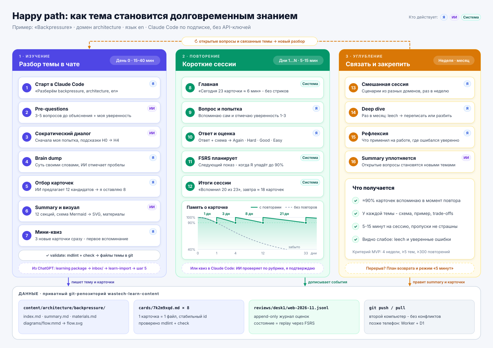

# wastech-learn

Персональный фреймворк обучения. Любую тему разбираешь в ИИ-чате, например в Claude Code или ChatGPT: архитектура, high-load, паттерны, Angular, .NET, польский язык. Потом тема превращается в четыре вещи:

- **карточки** интервального повторения: забытое показывается чаще, запомненное реже (FSRS, как в Anki);
- **summary** темы по единому шаблону: суть, ментальная модель, схема, пример, trade-offs;
- **материалы** для углубления;
- **визуальные разборы**: архитектурные схемы, таблицы сравнения, карты понятий, аннотированный код.

Методика опирается на книгу «Запомнить всё» (Make It Stick: Brown, Roediger, McDaniel) и другие доказательные практики: retrieval practice, интервалы, чередование, калибровку. Все данные — Markdown, SVG и JSONL в git. Размер карточек и документов держит в рамках [wastech-mdlint](https://github.com/VladimirMakarevich/wastech-mdlint).

## Статус

**Фаза 0 (документация) и веха M1 (контент-репозиторий с golden sample) завершены, инструменты разработки настроены.** Следующая веха — M2: пакеты `core` и `srs`; кода ядра пока нет. Требования, методика, модель данных и архитектура описаны в [docs/](docs/README.md), план фаз — в [roadmap](docs/roadmap.md). UI — desktop-first Angular + CDK в стиле [прототипа](prototypes/desktop-ui/README.md) ([ADR-0006](docs/adr/0006-headless-core-angular-ui.md)).

## Два репозитория

| Репозиторий | Что внутри | Доступ |
| --- | --- | --- |
| `wastech-learn` (этот) | Документация, ядро и приложение, CLI, MCP-сервер, skills, шаблоны, пресет mdlint | Можно открыть |
| `wastech-learn-content` | Темы, карточки, summary, материалы, диаграммы, логи повторений | Приватный |

Почему так, объясняет [ADR-0001](docs/adr/0001-two-repositories.md). Устройство контент-репозитория описано в [content/repo-layout.md](docs/content/repo-layout.md).

## Как это работает (кратко)



Ещё две схемы — день 0 и сессия повторения — на странице [happy path](docs/product/happy-path.md).

## С чего начать чтение

1. [Happy path на схемах](docs/product/happy-path.md)
2. [Видение и цели](docs/product/vision.md)
3. [Сценарии пользователя](docs/product/journeys.md)
4. [Принципы обучения](docs/learning/principles.md)
5. [Карта всей документации](docs/README.md)

## Прототип UI

[Кликабельный прототип десктопного интерфейса](prototypes/desktop-ui/README.md) на данных golden sample: главная, сессия повторения, темы, карточки, статистика, настройки. Открывается как `prototypes/desktop-ui/index.html`.

## Разработка

Нужен Node ≥24.17 (`.nvmrc`). Все инструменты — точные версии в devDependencies.

```bash
npm ci
npm run lint           # всё: lint:code + lint:docs (0 ошибок — условие готовности)
npm run lint:code      # ESLint (границы пакетов ядра), Stylelint, проверка Prettier, tsc -b
npm run lint:docs      # wastech-mdlint по docs/, .rules/, skills
npm run fix            # все автоисправления: ESLint, Stylelint, Prettier
npm run docs:view      # просмотр документации на 127.0.0.1:4180: схемы, подсветка, граф ссылок
```

Правила разработки — в [.rules/](.rules/README.md) (на английском: их читают и агенты), вход для агентов — [AGENTS.md](AGENTS.md). CI на каждый push в `main` и каждый pull request: `.github/workflows/ci.yml` (код) и `.github/workflows/markdown-lint.yml` (документация).

## Лицензия

[MIT](LICENSE). Лицензия распространяется на этот репозиторий: документацию, прототип и будущий код. Контент-репозиторий `wastech-learn-content` приватный, лицензия на него не действует.
