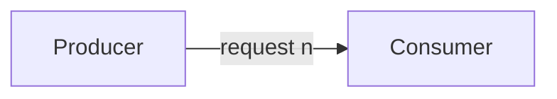

# Learning package — экспорт из любого чата

Для чатов без MCP (ChatGPT, Gemini и другие). Чат выдаёт **один Markdown-файл** в фиксированном формате. Пользователь сохраняет его в `inbox/` контент-репозитория, а `learn-import` в Claude Code раскладывает файл по темам. Так захват работает без API-ключей и без серверов.

## Формат

````md
---
package: wastech-learn/v1
source: chatgpt
lang: en
domain: architecture
topic: backpressure
familiarity: new
created: 2026-11-25
---

# Backpressure

## Topic

Key idea: …

## Summary

### TL;DR
…
### Mental model
…
(остальные секции шаблона summary: Diagram, Worked example, Trade-offs, When not to use,
Misconceptions, Comparison, Self-check, Related, Open questions, Sources)

## Materials

| Title | Kind | Why |
| --- | --- | --- |
| [Reactive Streams spec](https://www.reactive-streams.org/) | docs | Formal definition |

## Diagrams



## Cards

### why · understand · backpressure-purpose
Q: [Streaming] Why does a consumer signal demand to the producer?
A: To keep the producer from overflowing the consumer's buffer.
````

- Заголовок карточки: `### <type> · <bloom> · <idea>`, затем строки `Q:` и `A:`, при необходимости `R:` (рубрика, по строке на пункт) и `E:` (объяснение). Строка без метки продолжает поле выше.
- `id`, `created` и `origin` (`chatgpt` для пакета из ChatGPT, иначе `import`) назначают инструменты при записи. Отобранные кандидаты пишутся как `active`, отложенные — как `draft`.
- Пакет, который чат вернул внутри блока кода, тоже читается: внешний блок снимается.
- Пакет проверяется mdlint по пресету `inbox/*.md` (≤600 строк) и при импорте парсером `core`.

## Промпт экспорта

Пользователь копирует промпт в конец разговора. Промпт просит один блок кода Markdown в формате выше: front matter, `Topic` со строкой `Key idea:`, `Summary` с подсекциями шаблона, `Materials` таблицей `Title | Kind | Why`, диаграммы Mermaid (до 7 узлов, подписи на стрелках), 8–15 кандидатов смешанных типов по правилам формулировки и не выдумывать источники.

Три версии промпта лежат в skill: [en](../../skills/learn-import/templates/export-prompt.en.md), [ru](../../skills/learn-import/templates/export-prompt.ru.md), [pl](../../skills/learn-import/templates/export-prompt.pl.md). Тест сверяет, что все три требуют одни и те же поля, секции и лимиты. Язык промпта не влияет на `lang` пакета.

## Что делает `learn-import`

1. Разбирает пакет через `import_package`: front matter и структуру проверяет схема `core`, находки называют поле или номер кандидата. Инструмент ничего не меняет.
2. Ищет тему и дубли через `search`. Если тема уже есть, summary пишется через `save_summary` с `merge`: пустые секции заполняются, а текст непустых уходит в `## Open questions` и не перезаписывает существующий.
3. Показывает кандидатов карточек на отбор и правку, как в `learn-capture`. Generation effect сохраняется (LP-06).
4. Записывает файлы через MCP-инструменты, диаграммы рендерит в SVG.
5. Переносит пакет в `inbox/done/` отдельным вызовом `archive_package`, когда отобранное записано.

## См. также

- [Захват](capture.md) · [Требование FR-110](../requirements/fr-capture.md) · [Сценарий J-02](../product/journeys.md)
