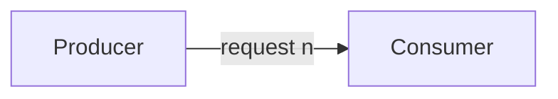

# Learning package — экспорт из любого чата

Для чатов без MCP (ChatGPT, Gemini и другие). Чат выдаёт **один Markdown-файл** в фиксированном формате. Пользователь сохраняет его в `inbox/` контент-репозитория, а `learn-import` в Claude Code раскладывает файл по темам. Так захват работает без API-ключей и без серверов.

## Формат

````md
---
package: wastech-learn/v1
source: chatgpt
lang: en
domain: architecture
topic: backpressure
familiarity: new
created: 2026-11-25
---

# Backpressure

## Topic

Key idea: …

## Summary

### TL;DR
…
### Mental model
…
(остальные секции шаблона summary: Diagram, Worked example, Trade-offs, When not to use,
Misconceptions, Comparison, Self-check, Related, Open questions, Sources)

## Materials

| Title | Kind | Why |
| --- | --- | --- |
| [Reactive Streams spec](https://www.reactive-streams.org/) | docs | Formal definition |

## Diagrams



## Cards

### why · understand · backpressure-purpose
Q: [Streaming] Why does a consumer signal demand to the producer?
A: To keep the producer from overflowing the consumer's buffer.
````

- Заголовок карточки: `### <type> · <bloom> · <idea>`, затем строки `Q:` и `A:`, при необходимости `R:` (рубрика) и `E:` (объяснение).
- `learn-import` сам назначает `id`, проставляет `status: draft`, `origin: chatgpt`, `created`.
- Пакет проверяется mdlint по пресету `inbox/*.md` (≤600 строк) и при импорте парсером `core`.

## Промпт экспорта

Пользователь копирует промпт в конец разговора:

```text
Export this conversation as a wastech-learn learning package (format v1).
Output ONE markdown code block and nothing else. Rules:
- Front matter: package: wastech-learn/v1, source, lang (en|ru|pl — the language
  I studied in), domain (kebab-case), topic (kebab-case), familiarity (new|familiar), created.
- Sections in order: Topic (one-sentence key idea in MY words if I gave them),
  Summary (### TL;DR, Mental model, Diagram, Worked example, Trade-offs,
  When not to use, Misconceptions, Comparison, Self-check, Related, Open questions, Sources),
  Materials (table Title|Kind|Why), Diagrams (mermaid, max 7 nodes, labels on edges),
  Cards.
- Cards: 8–15 candidates, mixed types (basic, cloze, why, compare, scenario, vocab).
  Each: "### <type> · <bloom> · <idea>", then "Q:" and "A:" lines; scenario adds "R:" rubric
  (≤5 points, mark required with (!)).
- Card rules: one idea per card; context prefix in [brackets]; question ≤25 words
  (scenario ≤60); answer ≤12 words (basic) or ≤40 words (why/compare); no yes/no questions;
  no enumerations — use cloze; 2–3 cards per idea from different angles.
- Do not invent sources; omit a section rather than fill it with filler.
```

Русская и польская версии промпта будут в `wastech-learn/skills/learn-import/templates/`. Язык промпта не влияет на `lang` пакета.

## Что делает `learn-import`

1. Валидирует front matter пакета и структуру.
2. Находит тему через `search`. Если она уже есть, предлагает слияние: новые секции summary добавляются через `## Open questions`, а не перезаписывают существующие.
3. Показывает кандидатов карточек на отбор и правку, как в `learn-capture`. Generation effect сохраняется (LP-06).
4. Записывает файлы через MCP-инструменты, диаграммы рендерит в SVG.
5. Перемещает пакет в `inbox/done/`, чтобы его можно было найти.

## См. также

- [Захват](capture.md) · [Требование FR-110](../requirements/fr-capture.md) · [Сценарий J-02](../product/journeys.md)
