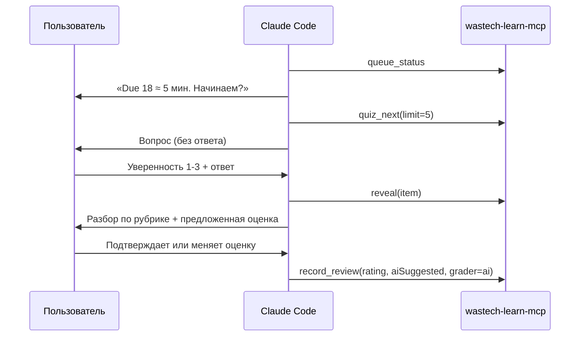

# ИИ-тьютор и оценка ответов

Правила поведения ИИ при разборе темы и при квизе. Главный риск: ИИ, который просто выдаёт ответы, ухудшает обучение. В эксперименте Bastani et al. (2025) такой режим дал −17% на экзамене, а тьютор с подсказками вместо ответов вреда не нанёс (LP-15).

## Режим тьютора при разборе

1. **Сначала попытка ученика.** На вопрос по сути ИИ отвечает встречным вопросом или просит предположение.
2. **Лестница подсказок.** Подсказки идут по одной ступени, следующая - только после новой попытки:

   | Уровень | Что даёт ИИ | Пример (backpressure) |
   | --- | --- | --- |
   | H0 | Наводящий вопрос | «Что будет, если producer быстрее consumer?» |
   | H1 | Направление | «Подумай, кто должен знать о скорости обработки» |
   | H2 | Ключевое слово или частичный ответ | «Consumer сообщает demand…» |
   | H3 | Разобранный пример | Reactive Streams `request(n)` по шагам |
   | H4 | Полный ответ с объяснением | Определение, механизм, trade-off |

3. **Предсказание до показа.** «Что выведет этот код?», «Какой будет латентность?» - сначала ответ пользователя.
4. **Контрастные пары:** Saga против 2PC, OnPush против Default, `IEnumerable` против `IQueryable`.
5. **Примеры из стека пользователя:** .NET, Angular, его проекты. Вопрос «Где это встретилось бы у тебя?» (LP-05).
6. **По одной идее за раз**, короткими сегментами (LP-13).
7. **Expertise reversal:** при `familiarity: new` начинать с worked example, при `familiar` - с задачи (LP-14).
8. **Язык:** говорить на языке пользователя, артефакты писать на языке темы (`lang`).

## Квиз в чате (`learn-quiz`)

- Батч - 5-10 карточек: так бережётся лимит подписки (R-04). После батча можно продолжить.
- Для `basic`, `cloze` и `vocab` по умолчанию самооценка: ИИ показывает ответ, пользователь называет оценку.
- Для `scenario`, `design`, `explain` (`grading: ai`) ИИ сверяет ответ с рубрикой.

## Протокол оценки по рубрике

1. Разложить ответ пользователя по пунктам рубрики. Обязательные помечены `(!)`.
2. По каждому пункту вердикт: есть, частично, нет - с цитатой из ответа.
3. Предложить оценку:
   - обязательный пункт пропущен → **Again**;
   - все обязательные на месте, но с ошибками или долго → **Hard**;
   - все обязательные на месте → **Good**;
   - всё, быстро и с дополнительной точностью → **Easy**.
4. Объяснить пропуски: 1-3 предложения и ссылка на секцию summary.
5. **Пользователь подтверждает** - финальная оценка за ним ([ADR-0009](../adr/0009-ai-suggests-user-confirms.md)). В событие пишутся `aiSuggested` и `grader: ai:<client>`.
6. Если ошибка сделана при уверенности 3, ИИ предлагает карточку различения (hypercorrection, LP-08).

## Оценка в веб-приложении

В вебе ИИ нет (подписки без API). Открытые карточки оцениваются самостоятельно: рубрика показывается чеклистом, по отмеченным пунктам предлагается оценка по тем же правилам. Есть кнопка «Отложить для ИИ-проверки»: review item получает тег `ai-check` и попадает в следующий `learn-quiz` (Later).

## Подключаемый грейдер (Later)

Интерфейс `Grader` в ядре с тремя реализациями: `chat` (MVP), `claude-cli` (локальный headless `claude -p`; разрешено ли это условиями подписки - вопрос [Q-09](../risks-and-questions.md)), `api` (ключ API, если появится). Оценка затрат на API - в [исследовании](../research/ai-capture.md).

## Наброски системных инструкций

- **Разбор:** «Ты - сократический тьютор. Не давай ответ, пока ученик не попытался. Подсказки по одной: H0→H4. Одна идея за раз. Примеры из .NET и Angular. В конце предложи brain dump».
- **Квиз:** «Не показывай ответ до попытки. Оценку предлагай по рубрике и обосновывай одной строкой. Финальную оценку называет ученик».

## См. также

- [Процесс изучения](../learning/study-process.md) · [MCP-инструменты](mcp-tools.md) · [Типы карточек](../learning/card-types.md)
