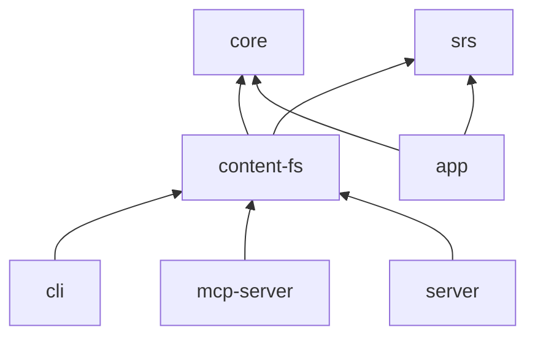

# Компоненты и контракты

Монорепозиторий `wastech-learn` на npm workspaces, как в `wastech-mdlint`. Требуется Node ≥24.17. Принцип headless core: вся логика в трёх пакетах, хосты только связывают их с вводом-выводом.

## Пакеты

| Пакет | Ответственность | Зависит от | Где работает |
| --- | --- | --- | --- |
| `@wastech-learn/core` | Zod-схемы (front matter, `learn.config.json`, событие, learning package), парсер Markdown (unified/remark — тот же стек, что в mdlint), компилятор content bundle (remark → rehype → Shiki, KaTeX, sanitize), правила `check` | unified, remark, rehype, zod, yaml | Node, браузер (парсинг) |
| `@wastech-learn/srs` | Адаптер ts-fsrs, replay журнала, очередь (лимиты, siblings, бэклог, режим «5 минут»), метрики | ts-fsrs | Node, браузер |
| `@wastech-learn/content-fs` | Чтение репозитория, дозапись JSONL (атомарно, свой файл на writer), кэш `node:sqlite`, watch файлов, рендер Mermaid | core, srs, mermaid-cli | Node |
| `@wastech-learn/cli` | `check`, `build`, `render`, `serve`, `export`, `simulate`, `new-id` | core, srs, content-fs | Node |
| `@wastech-learn/mcp-server` | Инструменты MCP ([mcp-tools](../ai/mcp-tools.md)) | core, srs, content-fs, `@wastech-mdlint/core` | Node (stdio; позже Worker) |
| `@wastech-learn/server` | Локальный HTTP: bundle, события, статус, SSE об изменениях | core, srs, content-fs, Hono | Node |
| `app` | Angular + CDK UI | core (типы bundle), srs (очередь в клиенте) | Браузер, Capacitor |
| `skills/*` | `learn-capture`, `learn-import`, `learn-quiz`, … | — (инструкции над MCP и CLI) | Claude Code |

## Правила зависимостей



- `core` и `srs` не зависят друг от друга, от Node API и от файловой системы, поэтому работают в браузере.
- Хосты не содержат бизнес-логики. Новая логика попадает в `core`, `srs` или `content-fs`, как в `wastech-mdlint`, где `core` владеет всем конвейером.
- `app` никогда не импортирует `content-fs`. Состояние он получает только через `ReviewStore`.

## Контракты

**`ReviewStore`** — единственный способ UI работать с событиями ([ADR-0006](../adr/0006-headless-core-angular-ui.md)):

```ts
interface ReviewStore {
  loadEvents(): Promise<ReviewEvent[]>;          // весь журнал (или с последнего снапшота)
  append(events: ReviewEvent[]): Promise<void>;  // идемпотентно по event.id
  onExternalChange(cb: () => void): Unsubscribe; // git pull, другой writer
}
// Фаза 1: HttpReviewStore → local server → reviews/<device>/web-YYYY-MM.jsonl
// Фаза 2: SqliteOutboxReviewStore → Capacitor SQLite + синхронизация с Worker/D1
```

**Content bundle** — результат `wastech-learn build`, его читает UI:

```ts
interface ContentBundle {
  version: 1;
  builtAt: string;
  domains: DomainMeta[];
  topics: TopicMeta[];      // путь, title, lang, familiarity, related, html секций summary
  cards: CardEntry[];       // id, type, variants[], questionHtml, answerHtml, rubric[], contentHash, topic
  assets: Record<string, string>; // путь → URL (SVG, audio)
  searchIndex: unknown;     // сериализованный MiniSearch
}
```

**Grader** — подключаемая оценка открытых ответов ([tutor-and-grading](../ai/tutor-and-grading.md)): `grade(question, rubric, answer) → { verdicts[], suggestedRating, explanation }`. Реализации: `chat` (сам ИИ в чате, MVP), `claude-cli` и `api` (Later).

## Безопасность рендера

HTML в bundle создаётся только компилятором из собственного контента и проходит `rehype-sanitize` со списком разрешённых тегов (SVG, KaTeX, классы Shiki). UI вставляет его без повторной санитизации, поэтому чужой HTML в bundle не допускается.

## См. также

- [Обзор](overview.md) · [Потоки данных](data-flows.md) · [Журнал событий](../content/review-log.md)
