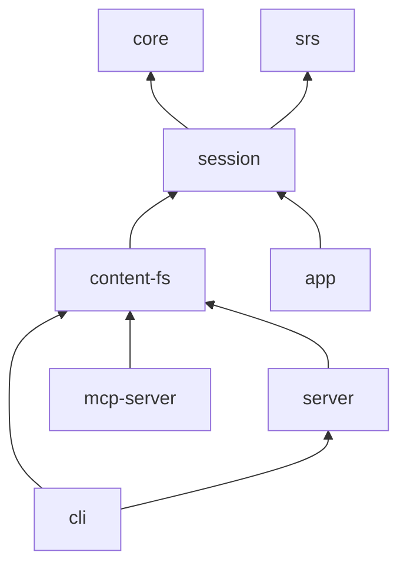

# Компоненты и контракты

Монорепозиторий `wastech-learn` на npm workspaces, как в `wastech-mdlint`. Требуется Node ≥24.17. Принцип headless core: вся логика в четырёх пакетах, хосты только связывают их с вводом-выводом.

## Пакеты

| Пакет | Ответственность | Зависит от | Где работает |
| --- | --- | --- | --- |
| `@wastech-learn/core` | Zod-схемы (front matter, `learn.config.json`, событие, learning package, входы инструментов MCP), парсер Markdown (unified/remark — тот же стек, что в mdlint), сериализация файлов контента из полей (`serialize/`), поиск MiniSearch (`search/`), генераторы `id` и ULID с внешним RNG, компилятор content bundle (remark → rehype → Shiki, KaTeX, sanitize), `edit/`, правила `check`, каталог сообщений ru/en/pl, каноничный пресет mdlint `preset/content.mdlint.jsonc` | unified, remark, rehype, zod, yaml, shiki, minisearch | Node, браузер |
| `@wastech-learn/srs` | Адаптер ts-fsrs, replay журнала, очередь (лимиты, siblings, бэклог, режим «5 минут»), симуляция бэклога, метрики | ts-fsrs | Node, браузер |
| `@wastech-learn/session` | Сессия повторения поверх `core` и `srs` ([ADR-0015](../adr/0015-session-package.md)): перевод значений `core` в порты `srs`, сборка событий (`review`, `undo`, `suspend`, `unsuspend`, `reset`), правило leech, прогноз интервалов четырёх кнопок, журнал в памяти с replay по одному review item, движок сессии (режимы, learning steps в ходе сессии, отмена, bury, suspend, reset, внешние изменения), подсказка оценки по рубрике и итоги | core, srs | Node, браузер |
| `@wastech-learn/content-fs` | Чтение репозитория и снимок по времени изменения файлов, проверка с наложением (mdlint + `check`), транзакция записи группы файлов, хранилище `requestId`, запись тем, карточек, summary, materials и диаграмм, `saveSource`, статус карточки и темы, удаление карточки и его отмена до коммита (транзакция умеет удалять файлы), `inbox/`, квиз (replay в памяти, дозапись событий `mcp` через `session`), дозапись JSONL (атомарно, свой файл на writer), наблюдение за файлами (`watchRepository`: `content`, `reviews`, `config`, `other`, без своей дозаписи), модуль `git/` (запуск git без оболочки, разбор `status --porcelain=v2` с классификацией путей и причинами блокировки, сообщение коммита, `syncRepository` и `pullRepository` с откатом при сбое — [ADR-0017](../adr/0017-app-server-writes-and-git.md)), рендер Mermaid | core, srs, session, `@wastech-mdlint/core`; mermaid-cli через `npx` с точной версией, не зависимостью | Node |
| `@wastech-learn/cli` | `check`, `build`, `render`, `simulate` (M2), `new-id`, `hook post-tool-use` (M3), `serve` (M4); `export` — позже | core, srs, content-fs, server (для `serve`) | Node |
| `@wastech-learn/mcp-server` | `wastech-learn-mcp`: инструменты MCP ([mcp-tools](../ai/mcp-tools.md)) поверх `content-fs`, маппинг ошибок в `{ code, message, hint }` | core, srs, content-fs, `@modelcontextprotocol/sdk` | Node (stdio; позже Worker) |
| `@wastech-learn/server` | Локальный HTTP на `127.0.0.1`: сборка приложения, bundle с `ETag`, журнал, приём событий `web`, состояние git (`GET /api/git`), синхронизация и получение (`POST /api/git/sync`, `/api/git/pull`), архив, возврат и удаление карточки и архив темы (`/api/cards/:id/…`, `/api/topics/:domain/:topic/status`), `/api/source`, SSE об изменениях (и `git-changed`), общая очередь записей и git через `Workspace`, защита `Host`/`Origin`/`Content-Type`/размера тела | core, srs, content-fs, Hono, `@hono/node-server` | Node |
| `app` | Angular 22 + CDK UI (standalone, signals, zoneless, `@angular/build`): `data/` (`ReviewStore` и `HttpReviewStore` с очередью неотправленных событий, API, SSE, состояние git `GitStatus`), `edit/`, `shell/` (индикатор и ленивая панель синхронизации на CDK Dialog), `i18n/` (ru/en/pl на signals, плюралы через `Intl.PluralRules`), `ui/` (компоненты Evening Glass), `keys/`, директива `bundleHtml`; сборку в `dist/browser` раздаёт `server` | core (типы bundle), srs и session (replay, очередь и сессия в клиенте) | Браузер, Capacitor |
| `skills/*` | [`learn-capture`](../../skills/learn-capture/SKILL.md), [`learn-import`](../../skills/learn-import/SKILL.md), [`learn-quiz`](../../skills/learn-quiz/SKILL.md) | — (инструкции над MCP и CLI) | Claude Code |

## Правила зависимостей



- `core` и `srs` не зависят друг от друга, от Node API и от файловой системы, поэтому работают в браузере.
- `session` соединяет `core` и `srs` и тоже работает в браузере: логика ответа на карточку, нужная и квизу MCP, и приложению, живёт здесь, а не в хосте.
- Хосты не содержат бизнес-логики. Новая логика попадает в `core`, `srs`, `session` или `content-fs`, как в `wastech-mdlint`, где `core` владеет всем конвейером.
- `app` никогда не импортирует `content-fs`. Состояние он получает только через `ReviewStore`.

## Контракты

**`ReviewStore`** — единственный способ UI работать с событиями ([ADR-0006](../adr/0006-headless-core-angular-ui.md)):

```ts
interface ReviewStore {
  loadEvents(): Promise<ReviewEvent[]>;          // весь журнал (или с последнего снапшота)
  append(events: ReviewEvent[]): Promise<void>;  // идемпотентно по event.id
  onExternalChange(cb: () => void): Unsubscribe; // git pull, другой writer
}
// Фаза 1: HttpReviewStore → local server → reviews/<device>/web-YYYY-MM.jsonl
```

`HttpReviewStore` держит неотправленные события в outbox в памяти и в `localStorage`. Outbox общий для всех вкладок: вкладка подхватывает события, оставленные другой, и не затирает их своими. События уходят пачками не больше 200, пачку с ответом 413 сервер получает половинами. При отказе 400 выбрасывается только событие, которое назвал сервер (`index`); при `device-not-allowed` ждущие события получают текущее имя устройства, потому что их ещё нигде не записали. `loadEvents` добавляет к ответу сервера всё, что вкладка знала во время загрузки, поэтому оценка, отправленная параллельно с чтением журнала, не теряется.

**Порты `srs`.** `srs` не импортирует `core`, поэтому объявляет узкие входы: `ReplayEvent` (`id`, `ts`, `kind`, `item`, `rating`, `target`, `due`), `QueueCard` (`item`, `cardId`, `idea`, `domain`, `type`, `status`) и `SrsConfig`. Хост передаёт разобранные значения `core`; совместимость форм проверяет `satisfies` в `session/ports.ts`, поэтому переименование поля ломает сборку, а не replay.

**Путь записи MCP** — в `content-fs`: инструмент строит полные тексты файлов (`core/serialize`), `validateOverlay` прогоняет mdlint и `check` по репозиторию с наложенными файлами, `commitFiles` пишет группу атомарно с откатом, `runIdempotent` хранит ответы по `requestId` в `.cache/mcp/requests.jsonl`. Пути проходят `confinePath` после разрешения символических ссылок.

**Content bundle** — результат `wastech-learn build`, его читает UI:

```ts
interface ContentBundle {
  version: 1;
  builtAt: string;          // передаётся снаружи: повторная сборка даёт тот же файл
  domains: DomainMeta[];
  topics: TopicMeta[];      // путь, title, lang, familiarity, related, html секций summary
  cards: CardEntry[];       // id, type, created, file, variants[], questionHtml, reverseHtml, answerHtml, rubric[], contentHash, topic
  assets: Record<string, string>; // локальные картинки, которые не встроены; SVG встраиваются в HTML
  searchIndex?: string;     // сериализованный индекс MiniSearch из core/search; loadSearchIndex восстанавливает его в браузере
}
```

Пропуски cloze в HTML — `<span class="cloze" data-cloze="N">`: UI скрывает пропуск показываемого варианта. `reverseHtml` — то, что спрашивает вариант `rev` (для `vocab` без примера, который выдал бы слово), той же функцией `promptMarkdown`, что и квиз MCP. HTML на страницу ставит только директива `bundleHtml` — единственное место с `bypassSecurityTrustHtml`.

**Браузерная точка входа `core`.** Условие `browser` в `exports` ведёт на `dist/browser.js`: типы, схемы, каталог сообщений, ULID и загрузку индекса поиска, без компилятора bundle и `check`. Иначе сборщик приложения превращал бы каждую грамматику Shiki в отдельный чанк.

**Grader** — подключаемая оценка открытых ответов ([tutor-and-grading](../ai/tutor-and-grading.md)): `grade(question, rubric, answer) → { verdicts[], suggestedRating, explanation }`. Реализации: `chat` (сам ИИ в чате, MVP), `claude-cli` и `api` (Later).

## Безопасность рендера

HTML в bundle создаётся только компилятором из собственного контента и проходит `rehype-sanitize` со списком разрешённых тегов (SVG, KaTeX, классы Shiki). UI вставляет его без повторной санитизации, поэтому чужой HTML в bundle не допускается.

## См. также

- [Обзор](overview.md) · [Потоки данных](data-flows.md) · [Журнал событий](../content/review-log.md)
