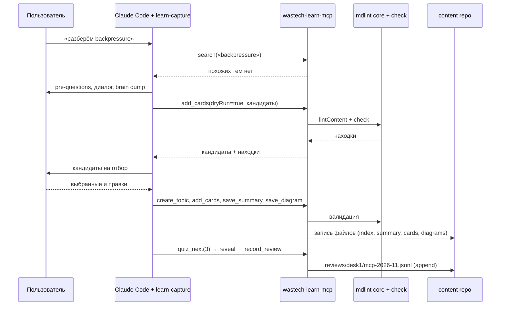
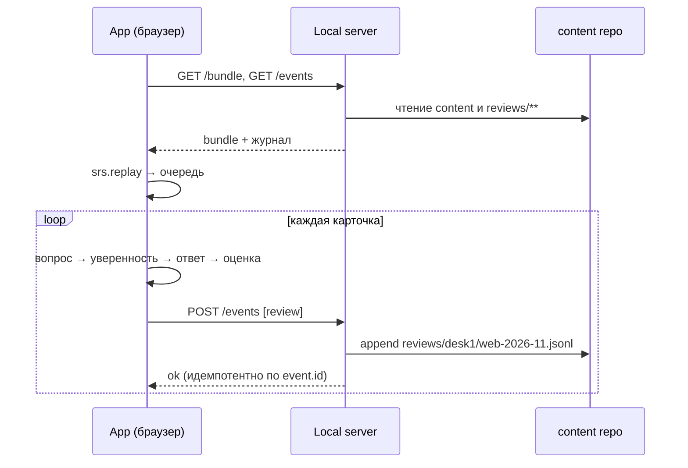
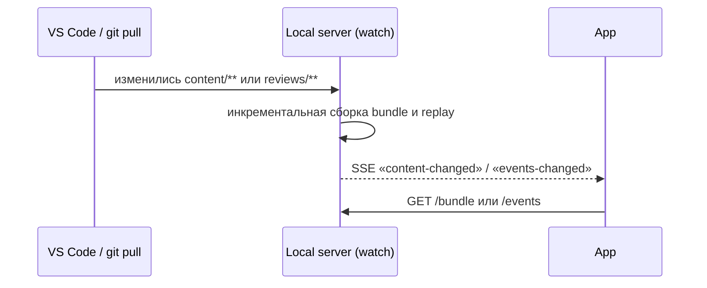
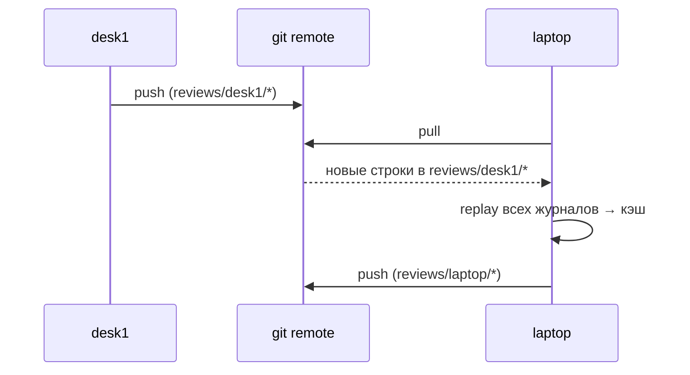

# Потоки данных

Sequence-диаграммы ключевых потоков фазы 1. Участники описаны в [обзоре](overview.md) и [компонентах](components.md).

## Захват темы в Claude Code (J-01)

## Повторение в приложении (J-03)

## Квиз в чате (J-09)

Последовательность описана в [tutor-and-grading.md](../ai/tutor-and-grading.md#квиз-в-чате-learn-quiz). MCP-сервер сам делает replay из журнала и кэша, `record_review` пишет в файл writer `mcp`.

## Изменение файлов и пересборка

## Синхронизация между компьютерами (J-08)

Конфликтов нет: каждое устройство и каждый writer пишут только в свой файл ([sync.md](sync.md)).

## Импорт learning package (J-02)

1. Пользователь кладёт файл в `inbox/`.
2. `learn-import` вызывает `import_package`. Тот разбирает пакет через схему `core` и возвращает тему и кандидатов.
3. Дальше всё как при захвате: отбор, `add_cards`, `save_summary`, `save_diagram`, валидация.
4. Исходник перемещается в `inbox/done/`.

## См. также

- [Компоненты](components.md) · [MCP-инструменты](../ai/mcp-tools.md)
