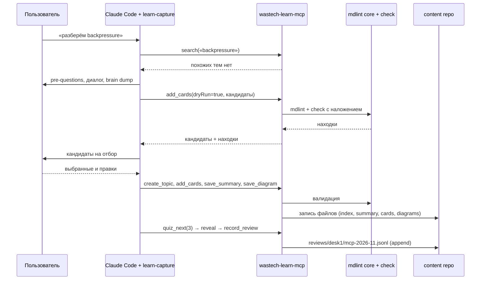
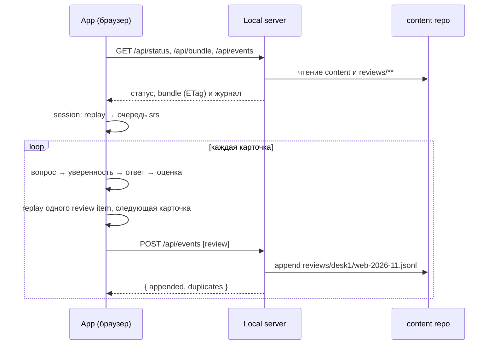
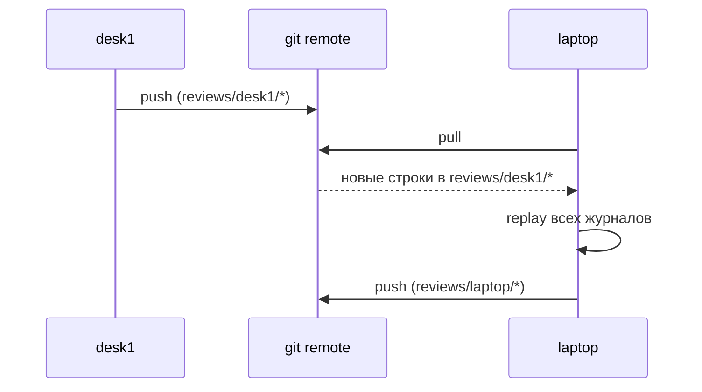

# Потоки данных

Sequence-диаграммы ключевых потоков фазы 1. Участники описаны в [обзоре](overview.md) и [компонентах](components.md).

## Захват темы в Claude Code (J-01)



## Повторение в приложении (J-03)



Сервер принимает только события `writer: web` своего устройства, каждое через схему `core`; повтор `id` пропускается. Запрос с чужим `Host` или `Origin`, не JSON или тело больше 256 KB отклоняются (`403`, `415`, `413`), CORS-заголовков нет. Пока сервер недоступен, события ждут в `ReviewStore` приложения и досылаются позже.

## Квиз в чате (J-09)

Последовательность описана в [tutor-and-grading.md](../ai/tutor-and-grading.md#квиз-в-чате-learn-quiz). MCP-сервер сам делает replay журнала в памяти, `record_review` пишет в файл writer `mcp`.

## Изменение файлов и пересборка

```mermaid
sequenceDiagram
  participant V as VS Code / git pull
  participant S as Local server (watchRepository)
  participant A as App
  V->>S: изменились content/**, reviews/** или learn.config.json
  S->>S: тишина 200 мс; своя дозапись не в счёт
  alt content или config
    S->>S: полная сборка bundle
    S-->>A: SSE content-changed или build-failed (находки)
    A->>S: GET /api/bundle
  else reviews
    S-->>A: SSE events-changed
    A->>S: GET /api/events, полный replay в клиенте
  end
  S-->>A: SSE git-changed (на любое изменение рабочего дерева)
  A->>S: GET /api/git
```

При `build-failed` сервер отдаёт последний собранный bundle, а приложение показывает баннер с файлом и строкой.

## Синхронизация между компьютерами (J-08)



Конфликтов нет: каждое устройство и каждый writer пишут только в свой файл ([sync.md](sync.md)). В приложении оба шага — кнопки панели синхронизации: «Синхронизировать» (`POST /api/git/sync`: commit путей синхронизации, `pull --rebase` с autostash, push) и «Получить» (`POST /api/git/pull`). Обе идут через ту же очередь сервера, что запись контента и дозапись журнала; после операции сервер шлёт `git-changed`, а наблюдатель — `content-changed` и `events-changed` для полученных файлов.

## Импорт learning package (J-02)

1. Пользователь кладёт файл в `inbox/`.
2. `learn-import` вызывает `import_package`. Тот разбирает пакет через схему `core` и возвращает тему и кандидатов.
3. Дальше всё как при захвате: отбор, `add_cards`, `save_summary` (в существующую тему — с `merge`), `save_diagram`, валидация.
4. `archive_package` переносит исходник в `inbox/done/`.

## См. также

- [Компоненты](components.md) · [MCP-инструменты](../ai/mcp-tools.md)
