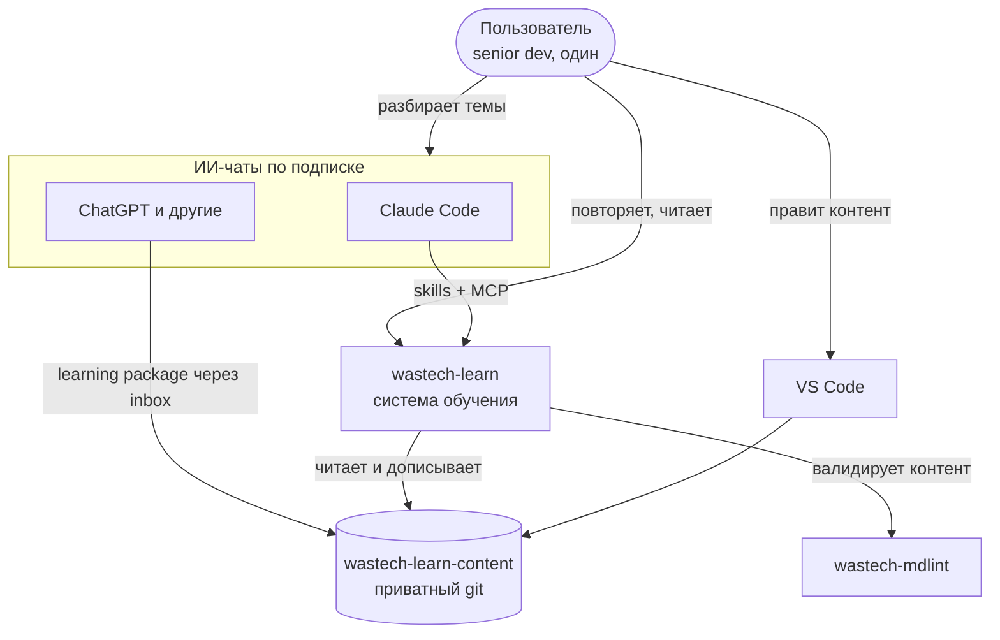
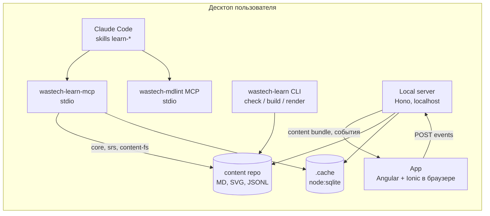

# Архитектура: обзор

Система local-first. Вся логика сосредоточена в headless TypeScript-ядре, хосты над ним тонкие. Источник истины — git-репозиторий контента. Ключевые решения: [ADR-0006](../adr/0006-headless-core-angular-ionic-ui.md) (ядро + UI), [ADR-0007](../adr/0007-local-server-phase-1.md) (локальный сервер), [ADR-0003](../adr/0003-append-only-review-log.md) (журнал).

## Контекст (C4, уровень 1)

## Контейнеры (C4, уровень 2), фаза 1

| Контейнер | Ответственность | Технология |
| --- | --- | --- |
| App | Повторение, чтение тем, поиск, статистика, настройки, i18n | Angular + Ionic (из `wastechlab-mobile-template`), ts-fsrs в клиенте |
| Local server | Отдаёт content bundle, принимает события и дописывает JSONL, следит за файлами, пересобирает кэш | Node 24 + Hono |
| wastech-learn-mcp | Инструменты захвата и квиза для Claude Code | Node 24, `@modelcontextprotocol/sdk`, stdio |
| CLI | `check`, `build` (bundle), `render` (диаграммы), `export` (CSV оптимизатора), `simulate` | Node 24 |
| Content repo | Источник истины: контент и журнал | git, Markdown, SVG, JSONL |
| Cache | Состояние review items после replay | `node:sqlite`, `.gitignore` |

## Фазы развёртывания

| Фаза | Где работает | Синхронизация | Для чего |
| --- | --- | --- | --- |
| 1 (MVP) | Localhost: `npx wastech-learn serve --content <path>` открывает браузер | git push/pull вручную, журнал разделён по device и writer | Десктоп, один или несколько компьютеров |
| 2 | Cloudflare Pages (статический app + bundle) + Worker + D1 (append-only события) за Cloudflare Access; Capacitor-приложение | Outbox на клиенте → D1 → периодический экспорт в `reviews/*.jsonl` в git | Телефон, remote MCP для claude.ai и ChatGPT |
| 3 | Как в фазе 2 | Как в фазе 2 | Оптимизатор, калибровка, MCP Apps, Piper |

Подробности синхронизации — в [sync.md](sync.md). Фаза 2 описана в [ADR-0013](../adr/0013-cloud-sync-phase-2.md).

## Ключевые качества

- **Headless.** UI не знает про файлы и git, он работает через `ReviewStore` и content bundle. Поэтому тот же UI работает и локально, и в облаке, и в Capacitor.
- **Детерминизм.** Состояние = replay(журнал, версия планировщика).
- **Без ключей.** ИИ только в чатах. Приложение и сервер не вызывают модели.
- **Валидация на входе.** Всё, что пишется в контент, проходит mdlint и `check`.

## См. также

- [Компоненты и контракты](components.md) · [Потоки данных](data-flows.md) · [Синхронизация](sync.md)
- [Исследование стека](../research/tech-stack.md)
