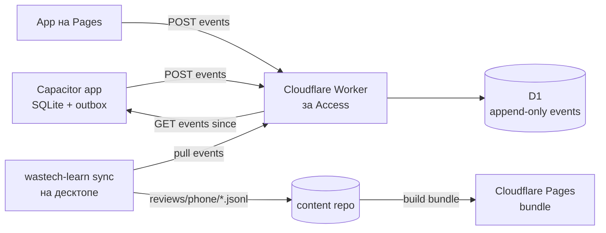

# Синхронизация устройств

Пользователь один, а устройств у него несколько: два компьютера сейчас, телефон позже. Главное правило: **журнал событий не конфликтует, потому что каждый writer дописывает только свой файл** ([ADR-0003](../adr/0003-append-only-review-log.md)).

## Фаза 1: git

| Что | Как |
| --- | --- |
| Контент (`content/**`) | Обычный git: правки в VS Code и через MCP, коммит и push вручную или по подсказке skill |
| Журнал | `reviews/<device>/<writer>-YYYY-MM.jsonl`: у каждого компьютера свой `device`, у каждого процесса (`web`, `mcp`, `cli`) свой файл |
| `.gitattributes` | `reviews/**/*.jsonl merge=union` для подстраховки, `* text=auto eol=lf` |
| Кэш | `.cache/` в `.gitignore`. После pull пересобирается: локальный сервер следит за `reviews/**` |
| Имя устройства | В `learn.local.json` (не коммитится), по умолчанию hostname (Q-03) |

**Порядок работы:**

1. Начало работы: `git pull`. Сервер видит новые строки и делает replay.
2. Повторение пишет строки в свой файл.
3. Конец работы: `git add reviews content && git commit && git push`.

Позже коммит журнала может делать CLI-команда `wastech-learn sync` (pull, commit, push) — опционально и только по команде пользователя.

**Что если забыл pull:** два устройства повторяли один и тот же review item независимо. После объединения replay применяет оба события по `ts`. FSRS корректно учитывает фактические интервалы, а в худшем случае карточка покажется на день раньше. Потерь данных нет.

## Фаза 2: облако для телефона

- На телефоне события сначала пишутся в локальный SQLite (outbox), а при появлении сети уходят в Worker и D1. Идемпотентность — по `event.id`.
- Источник истины — git. D1 играет роль транспорта и буфера: CLI на десктопе выгружает события в `reviews/phone/…jsonl` и коммитит их.
- Контент для телефона — тот же content bundle, его собирает CI контент-репозитория и публикует в Pages за Access.
- Хранилище PWA на iOS может очищаться, поэтому мобильная версия — нативная оболочка Capacitor с SQLite, а не PWA ([ADR-0006](../adr/0006-headless-core-angular-ui.md)).
- Бесплатного тарифа D1 (5 млн чтений и 100 тыс. записей строк в день) одному пользователю хватит с огромным запасом.

## Что отвергнуто

| Вариант | Почему нет |
| --- | --- |
| isomorphic-git на телефоне | Без SSH, ограничен памятью, падения при clone и pull |
| Supabase Free | Проект ставится на паузу после недели неактивности, а ритм у пользователя нерегулярный |
| Turso sync | Офлайн-записи в бете, нет разрешения конфликтов, неясное будущее после перехода в Supabase |
| Общий файл журнала | Конфликты при параллельной записи |

## См. также

- [Журнал событий](../content/review-log.md) · [ADR-0013](../adr/0013-cloud-sync-phase-2.md) · [Потоки данных](data-flows.md)
