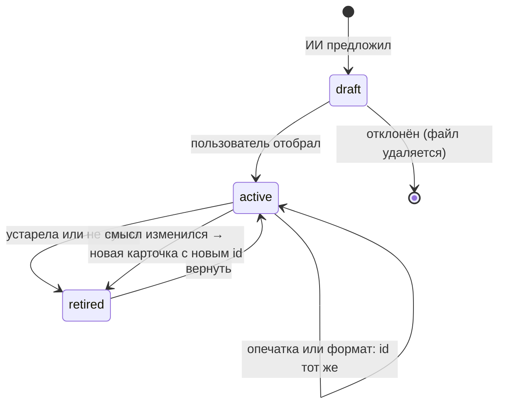

# Формат карточки

Одна карточка — один файл `content/<domain>/<topic>/cards/<id>.md`. В файле только контент, состояние повторения хранится в [журнале](review-log.md). Решения о формате приняты в [ADR-0002](../adr/0002-card-identity-and-review-items.md).

## Пример

```md
---
id: 7k2m9xqd
type: compare
status: active
bloom: analyze
grading: self
idea: saga-vs-2pc
tags: [distributed-transactions]
origin: claude-code
created: 2026-11-25
---

# Saga против 2PC: доступность

## Question

[Distributed transactions] Saga или 2PC: что происходит с доступностью при сбое участника?

## Answer

Saga не держит глобальных блокировок, доступность выше; цена — eventual consistency и компенсации.

## Explanation


2PC блокирует ресурсы до решения координатора.

## Sources

- [Summary: Comparison](../summary.md#comparison)
```

## Front matter

| Ключ | Обязателен | Значения | Зачем |
| --- | --- | --- | --- |
| `id` | да | `^[0-9a-hjkmnp-tv-z]{8}$` (Crockford base32, нижний регистр) | Стабильная идентичность, на неё ссылается журнал |
| `type` | да | см. [типы карточек](../learning/card-types.md) | Рендер, варианты, правила `check` |
| `status` | да | `draft`, `active`, `retired` | В очередь попадает только `active` |
| `bloom` | да | `remember`, `understand`, `apply`, `analyze`, `evaluate`, `create` | Баланс колоды (LP-09) |
| `grading` | да | `self`, `ai`, `none` | Кто предлагает оценку |
| `idea` | нет | `kebab-case` | Группирует 2–3 карточки одной мысли, для bury siblings |
| `tags` | нет | список `kebab-case` | Фильтры, cram, версии (`angular-19`) |
| `origin` | да | `claude-code`, `chatgpt`, `manual`, `import` | Откуда пришла карточка |
| `created` | да | `YYYY-MM-DD` | Аудит |
| `lang` | нет | `en`, `ru`, `pl` | Переопределяет язык темы (редко) |
| `langPair` | для `vocab` | `pl-ru`, `pl-en` | Направления вариантов и TTS |

## Секции

Порядок проверяют SEC-001 и SEC-002: `## Question`, `## Answer`, затем по необходимости `## Rubric`, `## Explanation`, `## Sources`.

- **H1** — короткий заголовок для списков и поиска. При повторении не показывается.
- **`Question`** — вопрос с префиксом контекста. В `cloze` и `grammar-cloze` здесь текст с пропусками `{{c1::…}}`.
- **`Answer`** — канонический ответ в пределах лимитов ([правила](../learning/card-writing-rules.md)).
- **`Rubric`** — для `scenario` и `design`: обязательные пункты чеклиста, помеченные `(!)`, не больше 5.
- **`Explanation`** — показывается после ответа: схема, пример, мнемоника.
- **`Sources`** — ссылка на секцию summary темы (проверяют REF-001 и REF-002) и внешние источники.

## Варианты и review items

Планировщик работает не с карточкой, а с **review item** = `<id>:<variant>`.

| Тип | Варианты | Пример review item |
| --- | --- | --- |
| `basic`, `why`, `compare`, `scenario` | `main` | `7k2m9xqd:main` |
| `reversed`, `vocab` | `fwd`, `rev` | `h3p8w1zr:rev` |
| `cloze`, `grammar-cloze` | `c1`…`c3` по пропускам | `q9t4c2mx:c2` |

Варианты одной карточки — «соседи» (siblings). В один день показывается только один из них (bury siblings).

## Жизненный цикл `id`



- **`id` генерирует инструмент** (`add_cards`, `learn-import`, CLI). Уникальность во всём репозитории проверяет `check`: mdlint не умеет сравнивать front matter между файлами.
- **Правка без смены смысла** (опечатка, формулировка) сохраняет `id` и историю. Журнал хранит `contentHash`, поэтому UI видит, что карточка изменилась после прошлого повторения.
- **Смысл изменился** — значит, это новая карточка с новым `id`, а старая уходит в `retired`. Решает пользователь. `check` предупреждает о крупной правке `active`-карточки (Q-05: порог «крупности»).
- **`retired` не удаляется** и `id` не переиспользуется. История нужна оптимизатору и статистике.

## См. также

- [Журнал событий](review-log.md) · [Файлы темы](topic-files.md) · [Мультиязычность](multilang.md)
