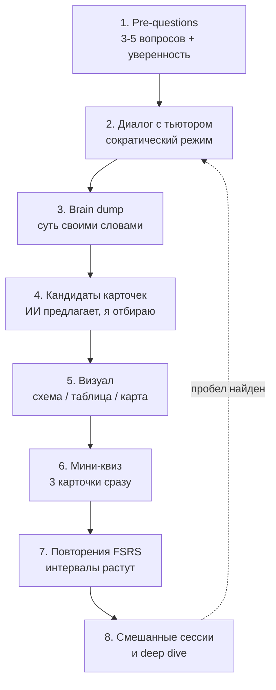

# Процесс изучения темы

Как одна тема проходит путь от разговора в чате до долговременного знания, и какой ритм держит этот процесс при нерегулярном графике. Обоснование шагов - [принципы](principles.md).

## Цикл темы

| Шаг | Что происходит | Принципы | Результат |
| --- | --- | --- | --- |
| 1. Pre-questions | Тьютор задаёт 3-5 вопросов до объяснения. Пользователь отвечает как может и отмечает уверенность | LP-16, LP-08 | Секция `Pretest` в `index.md` |
| 2. Диалог | Сократический метод, сначала попытка ученика, лестница подсказок. Для темы с `familiarity: new` - worked example, для `familiar` - сначала задача | LP-15, LP-14, LP-05 | Понимание, примеры из стека пользователя |
| 3. Brain dump | Пользователь без подсказок пишет суть в одном предложении и объясняет «как джуну». ИИ отмечает пробелы и заблуждения | LP-01, LP-06, LP-09 | TL;DR и ментальная модель для summary |
| 4. Карточки | Сначала поиск дублей. Затем ИИ предлагает 8-15 кандидатов разных типов. Пользователь отбирает 5-12 и правит формулировки | LP-06, LP-04, LP-13 | `cards/*.md` со статусом `active` (остальные - `draft` или удалены) |
| 5. Визуал | Схема Mermaid по правилам Mayer, таблица сравнения или карта понятий; аннотированный код | LP-12 | `diagrams/*.mmd` + `.svg`, секции summary |
| 6. Мини-квиз | Сразу 3 карточки - первое вспоминание, записывается как learning step | LP-01, LP-11 | События `review` в журнале |
| 7. Повторения | FSRS планирует; очередь смешивает домены | LP-02, LP-03, LP-10 | Растущая stability |
| 8. Углубление | Смешанные сессии, deep dive, переписывание leech | LP-03, LP-05, LP-07 | Обновлённые summary и карточки |

## Ритм

Ритм нерегулярный, поэтому ни один ритуал не обязателен. Система подсказывает, но не требует.

| Ритм | Длительность | Что делаем | Когда система предлагает |
| --- | --- | --- | --- |
| Сессия повторения | 5-15 мин | Очередь FSRS или режим «5 минут» | На главной: «N карточек ≈ M мин» |
| Захват темы | 15-40 мин | Цикл выше, шаги 1-6 | По инициативе пользователя |
| Смешанная сессия (Later) | 20-30 мин | Сценарии и сравнения из разных доменов | Раз в 7 дней, если накопилось ≥10 сценарных карточек |
| Deep dive (Later) | 30-60 мин | Leech, обновление summary, один design-prompt | Раз в месяц или при ≥5 leech |
| Рефлексия (Later) | 5-10 мин | 3 вопроса: что применил, что удивило, где ошибался уверенно | После смешанной сессии |

## Нагрузка и новые карточки

- Повторение занимает в среднем ~8 с (Nielsen). Бюджет в 15 минут даёт около 60-110 повторений, а это примерно 6-11 новых карточек в день.
- По умолчанию лимит - 10 новых в день для технических доменов и 10 новых слов (20 review items) для `lang-pl`. Жёсткий потолок - 20.
- Если бэклог превышает дневную норму повторений больше чем вдвое, новые карточки ставятся на паузу ([backlog](../scheduling/backlog.md)).

## Как ведёт себя тьютор

Подробно - в [tutor-and-grading.md](../ai/tutor-and-grading.md). Кратко:

- Не выдаёт ответ без попытки ученика. Подсказки идут по нарастающей (H0-H4).
- Просит предсказать вывод кода до того, как показать его.
- Даёт контрастные пары: Saga против 2PC, OnPush против Default.
- Берёт примеры из .NET и Angular, объясняет по одной идее за раз.
- В знакомых областях начинает с задачи, в новых - с worked example.

## Против разрастания колоды

- Карточка добавляется, только если её знание стоит ~10 минут будущего времени (Nielsen).
- Карточки привязаны к реальной работе: салиентные вопросы вида «где в моём сервисе пригодился бы Outbox?».
- Если повторение стабильно занимает больше 20 минут в день, новые карточки замедляются.
- Раз в месяц карточки, на которые ответ даётся не задумываясь и которые не нужны в работе, выводятся в `retired`.

## См. также

- [Типы карточек](card-types.md) · [Правила формулировки](card-writing-rules.md)
- [Захват из чатов](../ai/capture.md) · [Сценарий J-01](../product/journeys.md)
