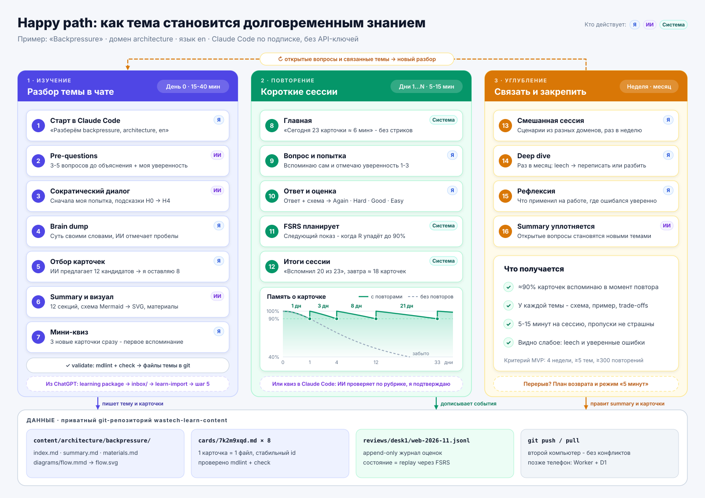
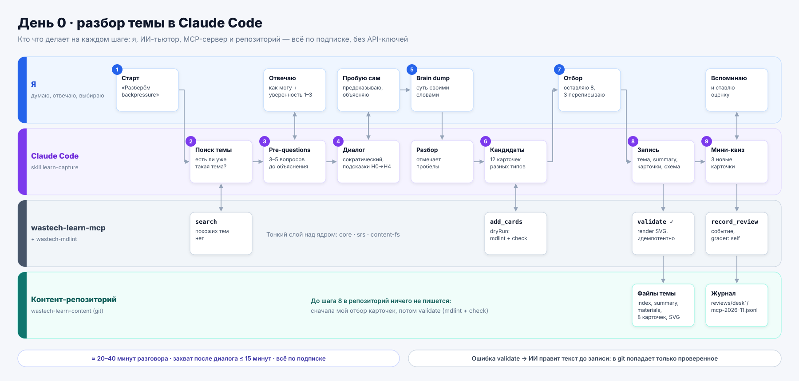
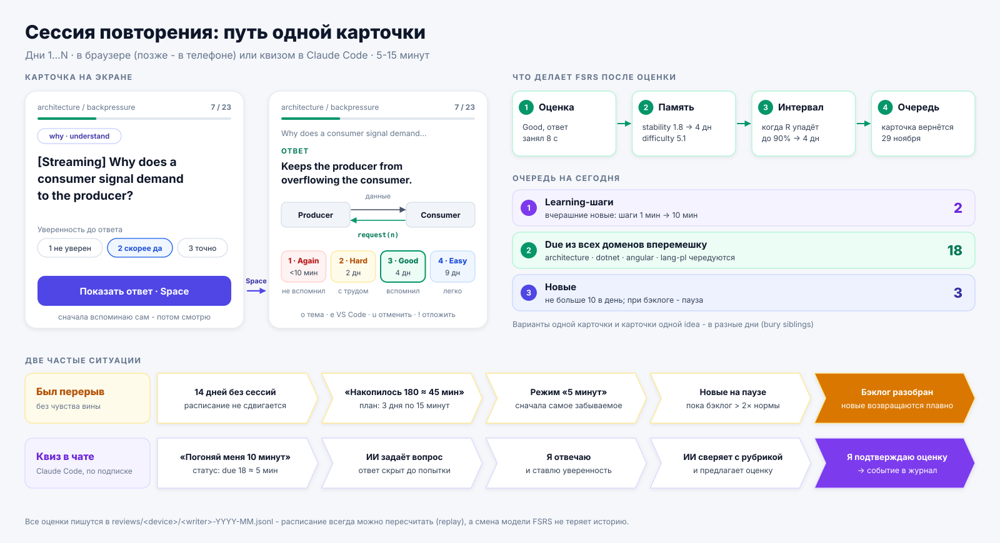

# Happy path: весь процесс на схемах

Как система выглядит в работе, если всё идёт по плану. Пример - тема «Backpressure» в домене `architecture` на английском, разобранная в Claude Code по подписке. Три схемы идут от общего к частному: весь путь темы, первый день, одна сессия повторения.

Схемы собирает скрипт [generate.py](../assets/happy-path/generate.py), тексты правятся в нём. Пересборка SVG и PNG: `python3 docs/assets/happy-path/generate.py`. PNG-версии (2x) удобно пересылать: [весь путь](../assets/happy-path/01-overview.png) · [день 0](../assets/happy-path/02-day0-capture.png) · [сессия повторения](../assets/happy-path/03-review-session.png).

## 1. Весь путь темы

- **Изучение (день 0, шаги 1-7).** Тьютор не выдаёт ответы, а ведёт: pre-questions, сократический диалог, brain dump. Карточки предлагает ИИ, отбираю я. Всё, что попадает в git, проверено mdlint и `check` ([study-process](../learning/study-process.md)).
- **Повторение (дни 1…N, шаги 8-12).** Короткие сессии, когда удобно. FSRS показывает карточку, когда вероятность вспомнить падает до 90%, поэтому интервалы растут: 1 → 3 → 8 → 21 день (график в центре; шкала дней сжата). Без повторов кривая уходит вниз ([srs](../scheduling/srs.md)).
- **Углубление (неделя, месяц, шаги 13-16).** Смешанные сессии, починка leech, рефлексия. Открытые вопросы превращаются в новые темы - пунктирная петля сверху.
- **Данные.** Тема и карточки - Markdown и SVG, оценки - append-only журнал, синхронизация - git ([repo-layout](../content/repo-layout.md)).

## 2. День 0: разбор темы в Claude Code

- Четыре дорожки показывают, кто действует на каждом шаге. Двойные стрелки - вопрос и ответ.
- До шага 8 в репозиторий ничего не пишется. Кандидаты проходят `add_cards` с `dryRun` и мой отбор, запись идёт только после `validate`.
- Мини-квиз (шаг 9) сразу записывает первые оценки в журнал writer `mcp` ([capture](../ai/capture.md), [mcp-tools](../ai/mcp-tools.md)).
- Из ChatGPT путь короче: learning package → `inbox/` → `learn-import`, дальше с шага 6 ([learning-package](../ai/learning-package.md)).

## 3. Сессия повторения: путь одной карточки

- **Слева - два экрана.** Сначала вопрос и уверенность, потом ответ со схемой и четыре кнопки с прогнозом интервала. Hard - это зачёт «с трудом» ([interaction](../ux/interaction.md)).
- **Справа - что делает FSRS.** После Good stability растёт, и карточка вернётся через 4 дня. Очередь дня: сначала learning-шаги, потом due из всех доменов вперемешку, потом новые в пределах лимита.
- **Внизу - две частые ситуации.** Возврат после перерыва без чувства вины ([backlog](../scheduling/backlog.md)) и квиз в Claude Code, где ИИ сверяет ответ с рубрикой, а оценку подтверждаю я ([tutor-and-grading](../ai/tutor-and-grading.md)).

## Что схемы не показывают

- Числа на схемах иллюстративные: 12 кандидатов, 23 карточки, интервалы, stability.
- Мобильное приложение и облачная синхронизация - фаза 2 ([roadmap](../roadmap.md)).
- Ошибки и откаты (битый журнал, конфликт правок) описаны в [NFR](../requirements/nfr.md) и [sync](../architecture/sync.md).
