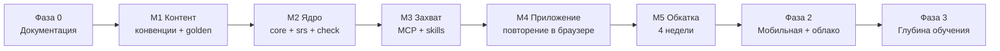

# Roadmap

Фазы проекта и определение MVP. Сроков нет: проект учебный, его темп задаёт пользователь. Порядок и критерии выхода зафиксированы.

## Фаза 0 — документация (текущая)

Требования, методика, модель данных, архитектура, ADR. Выход: документация проходит mdlint без ошибок, открытые вопросы перечислены в [risks-and-questions.md](risks-and-questions.md), пользователь согласовал документы.

## Фаза 1 — MVP: полный цикл на десктопе

| Веха | Содержание | Требования | Готово, когда |
| --- | --- | --- | --- |
| M1 Контент | Создан `wastech-learn-content`, пресет mdlint, `.gitattributes`, `learn.config.json`, golden sample (1 тех-тема ~10 карточек, 1 тема на ru, 10 польских слов) | FR-310, NFR-09 | **Сделано 2026-11-25:** 3 темы, 30 карточек, 0 ошибок mdlint; правила пресета проверены на заведомо плохих карточках |
| M2 Ядро | `core` (схемы, парсер, bundle, `check`), `srs` (ts-fsrs, replay, очередь, бэклог), `content-fs`, CLI `check/build/render/simulate`. Спека — [m2-core](tasks/m2-core/index.md) | FR-204, FR-208, FR-307, NFR-04, NFR-05, NFR-14 | **Сделано 2026-11-26:** тесты replay, property и golden зелёные, replay побайтно детерминирован на журнале ~1000 событий; симуляция: 14 дней перерыва на колоде 300 карточек разбираются за 3 сессии по 15 минут (медиана, 20 сидов) |
| M3 Захват | `wastech-learn-mcp` (инструменты контента и квиза), skills `learn-capture`, `learn-import`, `learn-quiz`, hook, промпт learning package. Спека — [m3-capture](tasks/m3-capture/index.md) | FR-101…FR-111, FR-115…FR-117, FR-210 | Одна реальная тема захвачена из Claude Code и одна из ChatGPT. **В работе:** сервер, hook, `new-id` и skills готовы (фазы 01–09); контент подключён к локальной сборке (фаза 10, AC-F12 пройден); приёмка на реальных темах — фаза 11, публикация в npm — после приёмки |
| M4 Приложение | Angular + CDK в стиле Evening Glass, i18n из шаблона: Home, Review, Session end, Topic, Browser, Stats (минимум), Settings, i18n ru/en/pl, TTS; локальный сервер. Спека — [m4-app](tasks/m4-app/index.md) | FR-2xx, FR-3xx, FR-401…FR-403, FR-5xx (MVP) | Сессия из 20 review items проходится только с клавиатуры. **Сделано 2026-11-27** на копии golden в e2e (медиана до следующей карточки 18 мс); приёмка на реальном контенте (AC-N10) — за владельцем |
| M5 Обкатка | 4 недели реального использования, сбор метрик, правка лимитов | — | Критерии ниже выполнены |

**Критерии выхода из MVP:**

- 4 недели реального использования, хотя бы 3 сессии в неделю;
- захвачено ≥5 тем в Claude Code и ≥1 импортирована из ChatGPT;
- ≥300 повторений в журнале;
- replay побайтно детерминирован на реальном журнале;
- симулированный 14-дневный бэклог разбирается сессиями по 15 минут не дольше 5 дней;
- 0 ошибок mdlint и `check` в контент-репозитории;
- захват одной темы занимает ≤15 минут (без учёта диалога).

## Фаза 2 — мобильная версия и облако

- Capacitor-сборка того же приложения, SQLite outbox ([sync](architecture/sync.md)).
- Cloudflare Pages + Worker + D1 + Access ([ADR-0013](adr/0013-cloud-sync-phase-2.md)).
- Remote MCP для claude.ai и ChatGPT developer mode (FR-112), запись через PR.
- Пуш-напоминания (FR-410), MCP Apps для квиза в чате (FR-113).

## Фаза 3 — глубина обучения

- Калибровка, fix list, Bloom-баланс, mastery (FR-404, FR-405, FR-407, FR-412).
- Оптимизатор весов FSRS (FR-408).
- Смешанные сессии и cram (FR-212, FR-213), журнал рефлексии (FR-406).
- Новые типы карточек: `design`, `bug`, `explain`, `occlusion`, `draw`, `salience`.
- D2 и Excalidraw (FR-114), карта знаний (FR-308).
- Piper TTS, type-in answer, переводы (FR-506…FR-508).
- Экспорт в Anki (FR-314), подключаемые грейдеры `claude-cli` и `api`.

## Что делать сразу после фазы 0

1. Решить блокирующие вопросы: Q-02 (модель FSRS), Q-03 (имя устройства), Q-04 (синхронизация пресета). **Решены 2026-11-26.**
2. Создать `wastech-learn-content` с golden sample по [content/](content/repo-layout.md).
3. Проверить пресет mdlint на golden sample и уточнить лимиты.
