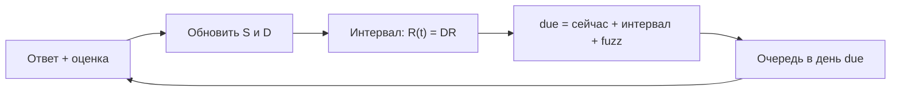

# Планирование повторений (SRS)

Когда показывать review item, решает FSRS - Free Spaced Repetition Scheduler. Обоснование выбора - [ADR-0004](../adr/0004-fsrs-via-ts-fsrs.md), подробности алгоритма - в [исследовании](../research/srs-algorithms.md).

## Модель памяти

FSRS хранит для каждого review item три величины:

- **retrievability (R)** - вероятность вспомнить прямо сейчас;
- **stability (S)** - за сколько дней R падает со 100% до 90%;
- **difficulty (D)** - сложность по шкале 1-10.

Интервал выбирается так, чтобы к следующему показу R упала до **desired retention** (DR). При DR = 0.90 интервал примерно равен S.

- Успешный ответ увеличивает S, и тем сильнее, чем ниже была R в момент ответа (desirable difficulties, LP-10).
- Провал (lapse) уменьшает S, а review item проходит relearning steps.

## Параметры по умолчанию

| Параметр | Значение | Почему |
| --- | --- | --- |
| Библиотека | `ts-fsrs` фиксированной версии (сейчас 6.0.1, MIT) | Эталонная TS-реализация, работает в браузере и на Node |
| Модель | FSRS-7 (по умолчанию в ts-fsrs 6) | Лучшая в srs-benchmark; повторы в тот же день моделируются нативно. Откат на FSRS-6 - настройкой; оптимизатор (`@open-spaced-repetition/binding`) поддерживает обе |
| Веса | По умолчанию до ~1000 повторений | Оптимизатору нужна история. С весами по умолчанию FSRS-7 работает примерно как оптимизированный FSRS-4.5 |
| Desired retention | 0.90 | Баланс нагрузки и удержания. Выше 0.95 нагрузка растёт круто |
| Learning steps | `1m`, `10m` | Не больше 2 шагов в пределах дня. Модель может удлинить шаг (`allowModelOverride`, по умолчанию для FSRS-7): новая карточка с Hard вернётся через часы, а не через минуты. Это удобно при коротких сессиях |
| Выпуск из learning | 1 день (`graduatingInterval`) | Интервал короче дня оставляет карточку в learning |
| Relearning steps | `10m` | Один шаг |
| Максимальный интервал | 365 дней | Технические знания устаревают: раз в год карточка всплывает на проверку |
| Fuzz | Включён явно: в ts-fsrs 6 он выключен по умолчанию | Разносит одинаковые даты. Сид - `cardId + reps`, поэтому replay воспроизводим |
| Граница дня | 04:00 по локальному времени (`tz` в событии) | Ночная сессия считается вчерашним днём |
| Порог leech | 8 lapses → `suspend` + fix list | Значение Anki по умолчанию |

Все параметры лежат в `learn.config.json` ([repo-layout](../content/repo-layout.md)) и записываются в `sched` каждого события.

## Смысл четырёх оценок

Пользователь выбрал 4 кнопки, как в Anki ([ADR-0005](../adr/0005-four-button-rating.md)). Под каждой кнопкой одна строка пояснения и прогноз интервала.

| Клавиша | Оценка | Когда нажимать | Пример подписи (ru) |
| --- | --- | --- | --- |
| `1` | Again | Не вспомнил или ошибся по сути | «Не вспомнил» |
| `2` | Hard | Вспомнил, но с заметным усилием. **Это зачёт** | «С трудом» |
| `3` / Space | Good | Вспомнил нормально | «Вспомнил» |
| `4` | Easy | Мгновенно и уверенно | «Легко» |

Ориентир Anki: Again в 5-20% ответов, Good в 80-95%. Если Hard часто ставят на самом деле забытым карточкам (больше 25% Hard, и после них карточки быстро проваливаются), UI мягко подсказывает, что Hard - это зачёт (FR-216).

## Порядок очереди

1. Learning и relearning, у которых подошёл шаг.
2. Due review items из всех доменов вперемешку (interleaving, LP-03). Варианты одной карточки и карточки одной `idea` разносятся по разным дням (bury siblings).
3. Новые карточки в пределах дневного лимита, блоком по теме, которая была захвачена последней.

При бэклоге порядок меняется: см. [backlog.md](backlog.md).

## Где выполняется

- Планировщик и очередь - пакет `srs`, чистые функции на TypeScript. Один и тот же код работает в приложении, в MCP-сервере (квиз в чате) и в CLI ([components](../architecture/components.md)).
- Оптимизатор весов (Later) - локальный Node с `@open-spaced-repetition/binding`. Запуск раз в месяц или при удвоении числа повторений. Новые веса принимаются, только если log loss на собственном журнале стал ниже.

## См. также

- [Бэклог и нерегулярный ритм](backlog.md) · [Метрики](metrics.md) · [Журнал событий](../content/review-log.md)
