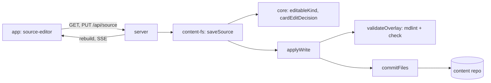

# Дизайн - приложение: правка тем и карточек в браузере

[⌂ index](index.md) · требования - [requirements.md](requirements.md) · запись контента - [дизайн M3](../m3-capture/design.md) · приложение - [дизайн M4](../m4-app/design.md)

## Обзор

Срез через четыре пакета. `core` - чистые правила: какой файл можно править и когда спрашивать о смысле. `content-fs` - `readSource` и `saveSource` поверх `applyWrite` (проверка mdlint и `check`, отказ `content-changed`, транзакция). `server` - свой `Workspace` и маршруты `/api/source`. `app` - редактор на `<textarea>` в Cards, на Topic и на Review. Журнал, bundle и SSE не меняются.

## Ключевые решения

| # | Решение | Почему | Отвергнуто |
| --- | --- | --- | --- |
| D1 | Запись только через `content-fs/write/source.ts` → `applyWrite` | Путь MCP: проверка до записи, атомарность, защита от чужой правки ([ADR-0012](../../adr/0012-two-tier-validation.md)) | `writeFile` в маршруте; инструменты MCP по полям - редактор работает с текстом |
| D2 | `core/edit/`: `editableKind(path)` → `card`, `topic-index`, `summary`, `materials` или ничего; `cardEditDecision(before, after)`; версия файла - `sha256Hex(text)` | Headless-ядро, тесты без диска | Правила в маршруте |
| D3 | Версия - хэш текста, не `mtime` | Переживает перезапуск сервера; `applyWrite` сравнивает текст | `mtime`, `ETag` |
| D4 | Порядок: версия → тот же текст (`unchanged`) → `id` → решение о смысле → два уровня проверки → запись; перед записью `applyWrite` ещё раз сверяет диск | Сначала дешёвое; гонка с VS Code закрыта дважды | Проверка до сверки версии |
| D5 | «Та же или новая» (AE-F11, AE-Q1) спрашивается, если карточка `active` до и после и: пропал вариант (смена `type`, удалённый пропуск cloze) или `Question` либо `Answer` изменились больше чем на 40% слов (`ACTIVE_EDIT_THRESHOLD`) **относительно открытого текста**. Новый вариант не спрашивает. После «та же» `active-edit` этого файла из находок убирается | История пропавшего варианта осиротеет, новый начнёт с нуля. `check` сравнивает с коммитом и спрашивал бы при каждой правке до коммита | `active-edit` из `check`; запрет смены `type` |
| D6 | «Новая карточка»: старый файл - текст **с диска** и `status: retired`; новый - правленый текст с новым `id`, `created` сегодня, `status: active`, `origin` старой; строка в `## Cards`. Общее с `updateCard` - в `write/successor.ts` | Правило [ADR-0002](../../adr/0002-card-identity-and-review-items.md) в одном месте | Копия логики |
| D7 | Сменился `#` карточки - `withCardLinks` правит `## Cards` (`incidental`). В `summary.md` и `materials.md` неизменённый `updated` становится сегодняшней датой в зоне конфига | Как `update_card` и `save_summary` | Дата на пользователе |
| D8 | `createServer` открывает `Workspace` (`now` и `random` от CLI); `PUT` идёт через `workspace.exclusive`; после записи сервер пересобирает bundle, публикует `content-changed` и только потом отвечает | Редактор закрывается над новым bundle; пересборка от watcher даст тот же `ETag` | Ждать watcher |
| D9 | Путь допускается, только если он назван в последнем собранном bundle (`card.file`; `index.md`, `summary.md`, `materials.md` его тем) и признан `editableKind`; затем `confinePath`; иначе 404 `source-not-found`. `guard` и лимит 256 KB - как у `POST /events` | Сервер не файловый браузер; символическая ссылка не проходит | Любой путь под `content/` |
| D10 | `<textarea>` без зависимостей; `Tab` не перехватывается (WCAG 2.1.2); глобальные клавиши в поле уже молчат (`isEditable`). Подтверждения - `ui/confirm-dialog` на `@angular/cdk/dialog`; несохранённое держат `canDeactivate` и `beforeunload` | Ноль новых пакетов (AE-N06); диалог пригодится app-sync-and-cards | CodeMirror; `confirm()` |
| D11 | Логика редактора - чистый `edit/editor-model.ts` на signals: `loading`, `editing`, `saving`, `blocked`, `decision`, `conflict` | Как D8 M4: Vitest без TestBed | Логика в компоненте |
| D12 | Находки `check` - через `formatFinding` на языке интерфейса; mdlint - его английским сообщением с номером правила. Находка в этом файле ставит курсор на строку, в другом - показана как `путь:строка` | У mdlint нет каталога ru и pl | Свой перевод mdlint |
| D13 | `e` - правка (Cards, Topic, Review после ответа), `Shift+E` - VS Code | AE-F05 | Новая клавиша |
| D14 | ADR-0017 общий с [app-sync-and-cards](../app-sync-and-cards/index.md) (`0017-app-server-writes-and-git.md`, его фаза 01): кто идёт первым, пишет его сразу на обе спеки. `Workspace` и очередь операций сервера (D6 там) - тоже общие, `PUT /api/source` встаёт в ту же очередь. [ADR-0007](../../adr/0007-local-server-phase-1.md) - датированная строка в «Последствия» | Одно решение о границе сервера, одна очередь записей | ADR и очередь на каждую спеку |

## Пакеты и модули

| Пакет | Что меняется |
| --- | --- |
| `core` | `edit/editable.ts`, `edit/decision.ts` (на `variantsFor`, `changedWordShare`, `readSections`), `schema/source.ts` (Zod-схемы запроса и ответа) |
| `content-fs` | `write/source.ts`; `write/successor.ts` из `cards.ts` отдельным коммитом `refactor:` |
| `server` | `ServerOptions.random`, `Workspace`, `GET` и `PUT /api/source`; `cli serve` передаёт `random` |
| `app` | `data/api.ts`; `edit/editor-model.ts`, `edit/source-editor.ts`, `edit/unsaved-guard.ts`; `ui/confirm-dialog.ts`; встраивание в `browser`, `topic`, `review`; `keys/`; словари ru/en/pl |

Границы из [.rules/architecture.md](../../../.rules/architecture.md) не меняются.

## Контракт `/api/source`

| Запрос | Ответ |
| --- | --- |
| `GET ?path=<путь>` | 200 `{ path, text, version }` · 404 `source-not-found` |
| `PUT` `{ path, version, text, meaning?: "same" \| "new" }` | 200 `{ status: "written" \| "unchanged", paths, card?: { id, retired }, findings, lint }` · 400 `body-invalid` · 404 `source-not-found` · 409 `content-changed` · 409 `decision-needed` `{ largeEdit, removedVariants }` · 422 `blocked` `{ findings, lint }` |

Изменённый `id` - это `blocked` с находкой `card-id-changed` на строке `id:`, в общем списке. Сравнение - с `id` до правки, а если старый текст не читается - с именем файла.

## Интерфейс

- **Cards:** редактор вместо содержимого боковой панели, панель шире. **Topic:** вместо оглавления, статьи и колонки; вкладки Summary, Паспорт, Материалы; summary - на секции, что была вверху экрана. **Review:** после ответа `e` открывает редактор вместо карточки, после закрытия карточка снова с ответом.
- Состояния: загрузка, правка, «Сохраняю…», «Не сохранено» с находками, диалог «та же или новая», «файл изменился в другом месте» с «Загрузить свежую версию». Вид - токены [DESIGN.md](../../../DESIGN.md); экраны делаются от [PRODUCT.md](../../../PRODUCT.md) со skill `impeccable`. Тексты по [tone-of-voice](../../../.rules/tone-of-voice.md), ключи проходят паритет и аудит литералов.

## Крайние случаи

- Файл, сломанный снаружи, можно открыть и починить, если он есть в последнем собранном bundle.
- Запись прошла, а сборка упала из-за другого файла: ответ `written`, приложение показывает баннер сборки.
- Файл удалён во время правки: 404, черновик остаётся.
- «Новая карточка» на Review: старая в `retired`, сессия по своему правилу идёт к следующей; новая придёт как новая по лимитам.
- `textarea` отдаёт `\n`: файл с CRLF после записи станет LF.

## Тесты

- `core`: `editableKind`; `cardEditDecision` - порог, смена `type`, удалённый и добавленный пропуск, `draft` и `retired` без вопроса.
- `content-fs` на копии golden: `written`, `unchanged`, `content-changed`, `card-id-changed`, `decision-needed`, `same` и `new`, `## Cards`, `updated`, недопустимые пути и ссылки.
- `server` через `app.request()`: коды, чужой `Origin` → 403, `text/plain` → 415, > 256 KB → 413, пересборка до ответа, две записи по очереди.
- `app`: Vitest для `editor-model` и `api.ts`; Playwright на golden-копии: Cards, находка → строка, summary с секции, Review с оценкой после правки, конфликт, только клавиатура, axe в обеих темах, 360 px.

## Схема

