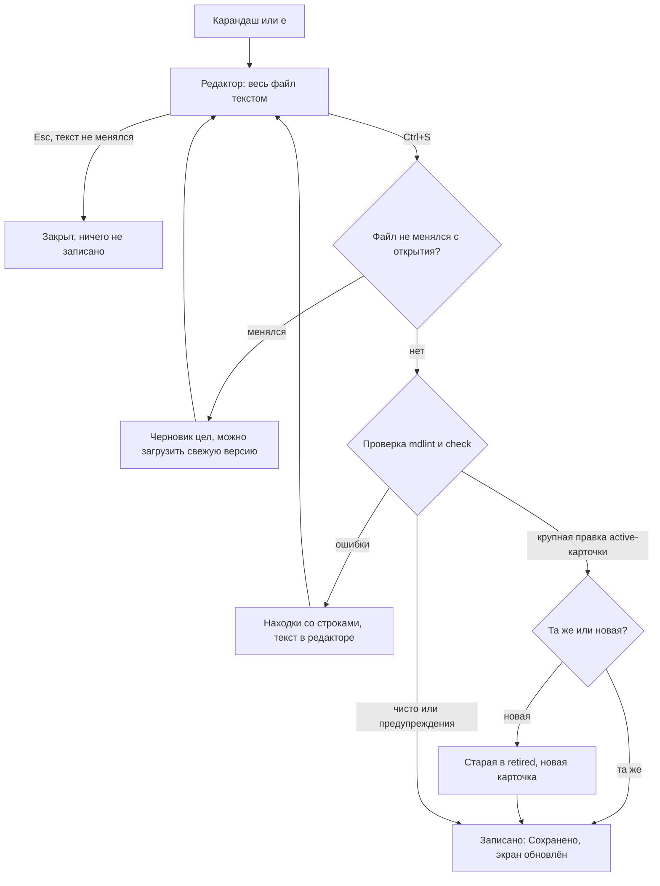
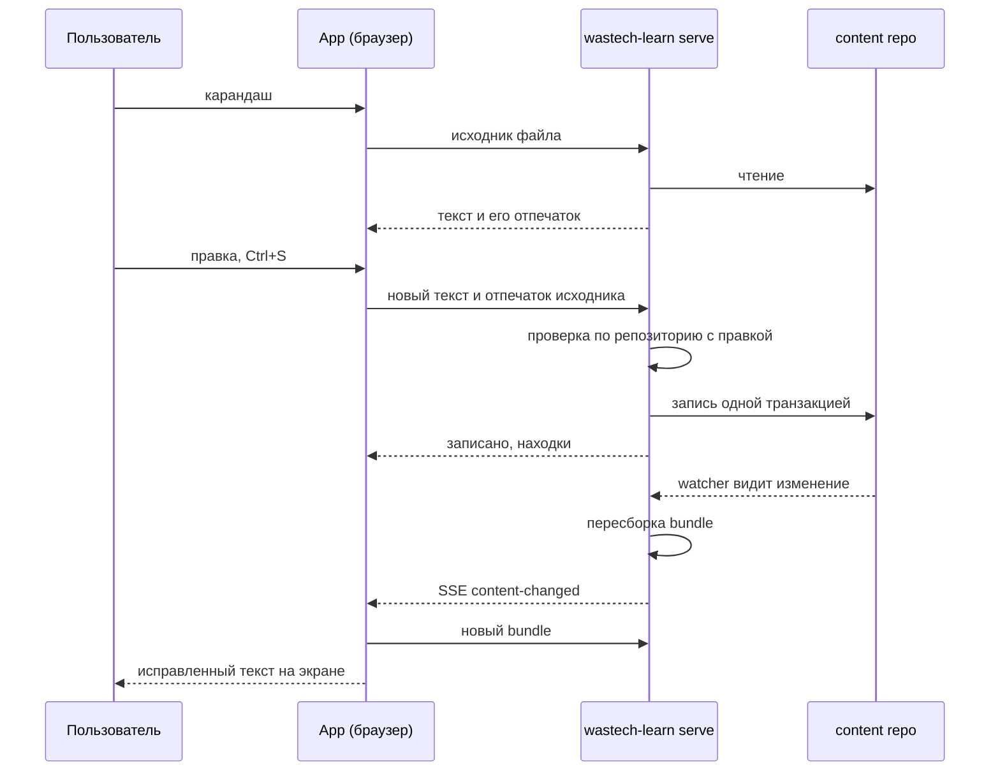

# Happy path — приложение: правка тем и карточек в браузере

[⌂ index](index.md)

## Одной фразой

Заметил неточность, пока повторяешь или читаешь, — нажал карандаш, поправил текст на месте, `Ctrl+S`, и через пару секунд приложение показывает исправленный вариант; файл в контент-репозитории уже изменён и проверен.

## До и после

| | Сейчас | После задачи |
| --- | --- | --- |
| Опечатка на Review | `e` → VS Code, найти место, сохранить, вернуться в браузер | `e` → текст карточки на месте, `Ctrl+S`, оценить дальше |
| Дополнить summary | Кнопка ведёт в `index.md`; открыть `summary.md` и найти секцию | Карандаш → `summary.md` уже на той секции, которую читаешь |
| Ошибка в правке | Видна баннером сборки, когда файл уже сохранён | Ничего не записано; находка со строкой рядом с текстом |
| Смысл карточки изменился | Помнить правило: старую в `retired`, новую с новым `id` | Приложение спрашивает «та же или новая» и делает остальное |
| Файл поправили в другом месте | Приложение не участвует | Запись отказывается, черновик цел |
| Отправить правку в git | Терминал или агент | Так же; кнопка — в [app-sync-and-cards](../app-sync-and-cards/index.md) |

## Пример 1 — опечатка во время повторения

1. На карточке про backpressure после показа ответа пользователь видит «bufer» вместо «buffer» и жмёт `e`.
2. Вместо карточки — текст её файла: front matter, `# Заголовок`, `## Question`, `## Answer`. Курсор в тексте.
3. Он исправляет слово и жмёт `Ctrl+S`. Проверка проходит, файл записан, внизу — «Сохранено».
4. Карточка снова на экране с ответом, уже без опечатки. Пользователь жмёт `3`; оценка относится к исправленному тексту. Сессия идёт дальше.

## Пример 2 — дополнить summary при чтении

1. На странице темы пользователь дочитал до «Trade-offs» и хочет добавить пункт. Жмёт карандаш в шапке.
2. Открывается `summary.md` с курсором на строке `## Trade-offs`. Вкладки над текстом: Summary, Паспорт, Материалы.
3. Он дописывает строку и сохраняет. Сервер ставит в `updated` сегодняшнюю дату.
4. Редактор закрывается, страница показывает новый пункт на том же месте.

## Пример 3 — правка с ошибкой

1. В Cards пользователь правит карточку и случайно стирает заголовок `## Answer`. `Ctrl+S`.
2. Под текстом: «Не сохранено. Строка 14: в карточке нет секции Answer». Файл на диске не тронут.
3. Он выбирает находку — курсор встаёт на строку 14. Возвращает заголовок, сохраняет.

## Пример 4 — карточка теперь о другом

1. Пользователь переписывает вопрос active-карточки целиком: была доступность Saga и 2PC, стала их согласованность.
2. При сохранении приложение спрашивает: «Похоже, карточка теперь спрашивает о другом. Та же карточка — история повторений сохранится. Новая карточка — эта уйдёт в архив, а текст станет новой карточкой».
3. Он выбирает «Новая карточка». Старая получает `status: retired`, новая — файл с новым `id` и строку в `## Cards` темы. Обе правки — одной записью; новая карточка придёт в очередь как новая.

## Пример 5 — файл поправили в другом месте

1. Пользователь открыл карточку в редакторе, а агент в Claude Code тем временем поправил её через `update_card`.
2. При сохранении: «Файл изменился в другом месте после того, как вы начали правку. Ваш текст остался здесь».
3. Он копирует свою строку, жмёт «Загрузить свежую версию», подтверждает замену черновика, вставляет строку и сохраняет.

Числа и темы в примерах иллюстративные.

## Поток правки

## Что происходит при сохранении

