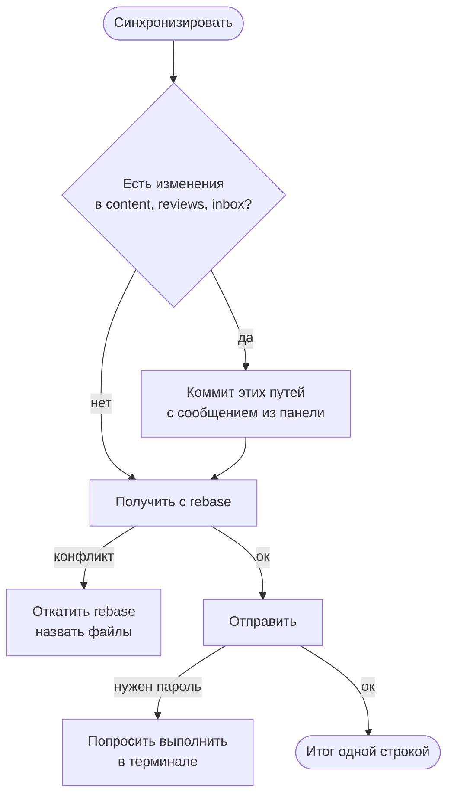
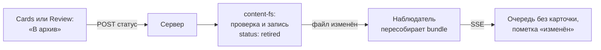

# Happy path - приложение: синхронизация с git и действия над карточками

[⌂ index](index.md)

## Одной фразой

Приложение показывает, что ещё не в git, отправляет оценки и правки одной кнопкой и убирает ненужные карточки там, где они попались.

## До и после

| | До | После |
| --- | --- | --- |
| Что не закоммичено | `git status` в терминале или вопрос агенту | Счётчик в боковой панели, список на странице темы, пометки в Cards |
| Конец работы | `git add reviews content && git commit && git push` или просьба к агенту | «Синхронизировать» на итогах сессии или в боковой панели |
| Начало работы на другом компьютере | `git pull` в терминале | «Получить» в боковой панели |
| Слабая карточка на повторении | Запомнить, открыть файл в VS Code, поменять `status` | «В архив» прямо на Review |
| Лишний черновик | Удалить файл в редакторе | «Удалить» в боковой панели Cards |

## Пример 1 - вечерняя сессия на `desk1`

1. Владелец проходит 15 минут повторения. На итогах: «Готово: 18 карточек · оценки этой сессии ещё не отправлены» и кнопка «Синхронизировать».
2. Он нажимает её. Панель показывает: войдёт `reviews/desk1/web-2026-11.jsonl`; не войдёт `.codex/config.toml` (коммитится вручную). Сообщение уже заполнено: `chore: reviews from desk1`.
3. «Синхронизировать» → «Отправлено: 1 коммит». Индикатор внизу боковой панели снова «всё сохранено».

## Пример 2 - новая тема после захвата

1. В Codex разобрана тема `angular/signals`. В приложении индикатор показывает «21 изменение».
2. На странице темы - блок «Не закоммичено»: `index.md`, `summary.md`, `materials.md`, диаграмма и 16 карточек, все «новые».
3. Синхронизация из боковой панели: сообщение `chore: reviews and 1 topic from desk1`, его можно заменить на `feat: angular signals`.

## Пример 3 - второй компьютер утром

1. На `laptop` индикатор показывает «↓ 2». Владелец нажимает «Получить».
2. Тема `angular/signals` и вчерашние оценки с `desk1` появляются без перезапуска; очередь Home пересчитана.

## Пример 4 - карточка больше не нужна

1. На Review попадается карточка про устаревший API. Владелец открывает действия (`!`) и выбирает «В архив». Карточка уходит, сессия идёт дальше.
2. В Cards с фильтром «Архив» она видна; «Вернуть» возвращает её в очередь со всей историей.
3. Черновик из прошлого захвата удаляется кнопкой «Удалить» после короткого подтверждения. Карточку с историей приложение сначала предлагает отправить в архив и удаляет только после явного подтверждения.

## Пример 5 - конфликт

1. Одна и та же карточка поправлена на двух компьютерах. «Синхронизировать» на втором коммитит локальную правку, получение упирается в конфликт.
2. Приложение возвращает репозиторий как был (локальный коммит остаётся) и пишет: «Не получилось объединить `content/dotnet/async-await/cards/q57c1sy6.md` - открой его в VS Code». Ничего не потеряно, журнал не тронут.

## Поток синхронизации

## Поток архива карточки

