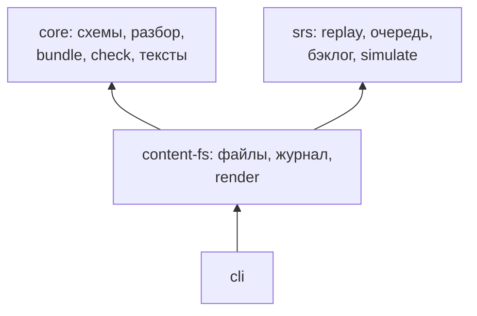

# Дизайн — M2, ядро

[⌂ index](index.md) · требования — [requirements.md](requirements.md)

## Обзор

Четыре пакета в `packages/`: чистые `core` и `srs`, `content-fs` для IO и тонкий `cli`. Хост читает файлы через `content-fs`, `core` разбирает и проверяет их, `srs` считает replay и очередь. Работаем внутри [.rules/architecture.md](../../../.rules/architecture.md), границы уже заданы в `eslint.config.js`.

## Ключевые решения

| # | Решение | Почему | Отвергнуто |
| --- | --- | --- | --- |
| D1 | `srs` объявляет узкий входной тип `ReplayEvent` (`id`, `ts`, `kind`, `item`, `rating`, `target`, `due`) и `QueueCard` (`item`, `cardId`, `idea`, `domain`, `type`, `status`). `ReviewEvent` из `core` ему структурно совместим, это проверяет `satisfies` в `content-fs` | `srs` не может импортировать `core`. Узкий порт — не второе описание той же формы: в нём только то, что нужно планировщику | Общий пакет схем (меняет таблицу пакетов, нужен ADR); схема события в `srs` (схемы принадлежат `core`) |
| D2 | Replay — последовательные `scheduler.review()` из `DefaultScheduler`, а не `Reschedule.replay()` | Нужны свои `reset`, `suspend`, `manual_due` и leech; `Reschedule` их не знает | `Reschedule.replay()` |
| D3 | `core` получает файлы как `ReadonlyMap<path, text>`, а время — параметром (`builtAt`, `now`) | Чистота и детерминизм; тот же код работает в браузере и на тестовых данных | Чтение файлов внутри `core` |
| D4 | SHA-256 через Web Crypto (`crypto.subtle`), поэтому хэши асинхронные | Есть и в браузере, и в Node 24 без импорта Node API | `node:crypto`; своя реализация SHA-256 |
| D5 | Находки `check` — данные (`ruleId`, `severity`, `file`, `line`, `params`). Тексты сообщений — каталог ru/en/pl в `core` с CLDR-плюралами через `Intl.PluralRules` и тестом паритета ключей | Тексты нужны CLI и MCP; правило i18n проекта; находки не содержат текста карточек | Тексты в CLI; английский только для CLI |
| D6 | Каноничный пресет mdlint — файл `packages/core/preset/content.mdlint.jsonc`. Сверка: каждое правило пресета (ключ — `rule` или `id` custom-правила) должно быть в копии контента с равными опциями; лишние правила разрешены | Решение Q-04; сравнение по структуре надёжнее номера версии | Сравнение по номеру версии в комментарии |
| D7 | Порядок очереди при бэклоге — параметр политики (`ascending-r`, `descending-r`, `relative-overdue`), по умолчанию `ascending-r` до итога `simulate` | Q-01 решается сравнением в симуляции, без переписывания очереди | Жёсткий порядок |
| D8 | Снимок replay — канонический JSON: review items по `item`, ключи по алфавиту, даты в ISO UTC | Побайтное сравнение в тесте детерминизма и будущем кэше | Сравнение объектов в памяти |

## Пакеты и модули

| Пакет | Модули (`src/`) |
| --- | --- |
| `core` | `schema/` (конфиг, front matter темы и карточки, событие v1), `parse/` (front matter, секции, варианты, `contentHash`), `bundle/` (remark → rehype → Shiki, KaTeX, sanitize), `check/` (по файлу на правило), `messages/` (ru, en, pl), `errors.ts` (`LearnError` с `code`) |
| `srs` | `scheduler.ts` (адаптер ts-fsrs), `replay.ts`, `day.ts` (граница дня в `timezone` через `Intl`), `queue.ts`, `backlog.ts`, `estimate.ts` (минуты по `durMs`), `simulate.ts` (синтетический журнал и сессии с seeded RNG), `snapshot.ts` |
| `content-fs` | `repo.ts` (загрузка конфига, `learn.local.json`, контента в map), `log-read.ts`, `log-append.ts`, `render.ts` (интерфейс `Renderer`; по умолчанию `npx` с точной версией mermaid-cli, без зависимости — R-06), `load.ts` (сборка входов для `srs` по D1) |
| `cli` | `bin.ts` и по файлу на команду: `check`, `build`, `render`, `simulate`; коды выхода `0`, `1`, `2` |

Корень: `packages/*` в workspaces, ссылки в `tsconfig.json`, Vitest с fast-check, копия golden sample в `fixtures/golden/`.

## Контракты

- **Входы `srs`:** `replay(events: readonly ReplayEvent[], scheduler, config: SrsConfig, now: Date): ReplayState`, `buildQueue(state, cards: readonly QueueCard[], config, now, { mode, order, estimates })`, `simulate(params, config, scheduler, seed)` и `compareBacklogOrders` по нескольким сидам. Все чистые; планировщик создаёт `createScheduler(config)` один раз асинхронно и передаёт внутрь.
- **Подготовка журнала** (дубли, порядок, `undo`) — `prepareEvents` в `srs`: тот же код нужен браузеру, а `log-read` вызывает его.
- **Бэклог по прошлым дням** считается из сегментов истории, которые replay записывает по каждому review item, а не повторным replay на каждый день. Так пауза и возврат новых выводятся из журнала без хранимого флага.
- **Siblings:** из конкурирующих за день побеждает тот, кто дольше ждёт; карточка, уже отвеченная сегодня, держит ключ дня.
- **База `active-edit`:** прежний текст изменённых карточек из `git HEAD` контента; вне git правило молчит (M2-Q4).
- **Bundle** — `ContentBundle` из [components](../../architecture/components.md) без `searchIndex`; `builtAt` передаётся снаружи, поэтому вывод `build` повторяем. `rehype-sanitize` идёт последним, его allowlist пропускает SVG, KaTeX и Shiki, а `style` — только без скобок и кавычек, то есть без `url()`.
- **Журнал:** `log-read` возвращает события и находки `{file, line, code}`; `log-append` пишет в `reviews/<device>/<writer>-YYYY-MM.jsonl` (месяц по `ts` в UTC) одним `write` с `fsync` и пропускает `id`, уже записанные в этот файл.
- **`render`:** маркер `<!-- source-sha256: … -->` первой строкой, как у текущего скрипта; `--check` только сообщает.

## Replay: семантика событий

| `kind` | Действие |
| --- | --- |
| `review` | `scheduler.review({ card, grade, now: ts })`, fuzz с сидом по `item` |
| `reset` | `scheduler.forget`: новая карточка, статистика сброшена |
| `suspend` / `unsuspend` | Флаг; память не меняется, очередь его учитывает |
| `manual_due` | Новый `dueAt`, память не меняется |
| `practice` | Пропуск |
| `undo` | Применяется до replay: отменённое событие исключается |

Leech — `lapses ≥ leechThreshold`; это признак в состоянии, событие пишет хост.

## Ошибки и пограничные случаи

- Ошибка схемы в контенте → находка `error` с файлом; `build` не пишет bundle, код `1`. Сбой IO или незнакомый ключ CLI → код `2`.
- Событие с незнакомым `item` (карточку удалили) хранится в снимке, но в очередь не попадает. Событие `v > 1` → находка, а не падение.
- `retired` и `draft` в очередь не попадают; `active`-карточка без событий — новая.
- Граница дня: событие в 03:30 при `dayStartsAt` 04:00 относится к прошлому дню; переход на летнее время покрыт тестом.

## Тестирование

- **Unit:** схемы, разбор, каждое правило `check`, политика очереди и бэклога.
- **Golden:** `check` и `build` на `fixtures/golden/`, снимок bundle.
- **Детерминизм:** журнал около 1000 событий → один снимок, также при перемешанных строках и файлах.
- **Property (fast-check):** лимиты, siblings, learning первыми, `undo` возвращает прежнее состояние.
- **Симуляция:** перерыв 14 дней разбирается сессиями по 15 минут не дольше 5 дней; бенчмарк NFR-05.
- **CLI:** коды выхода на временной копии golden sample.

## Схема

