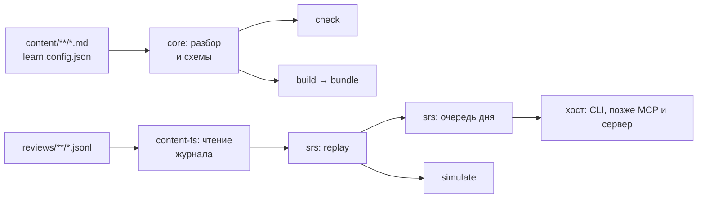
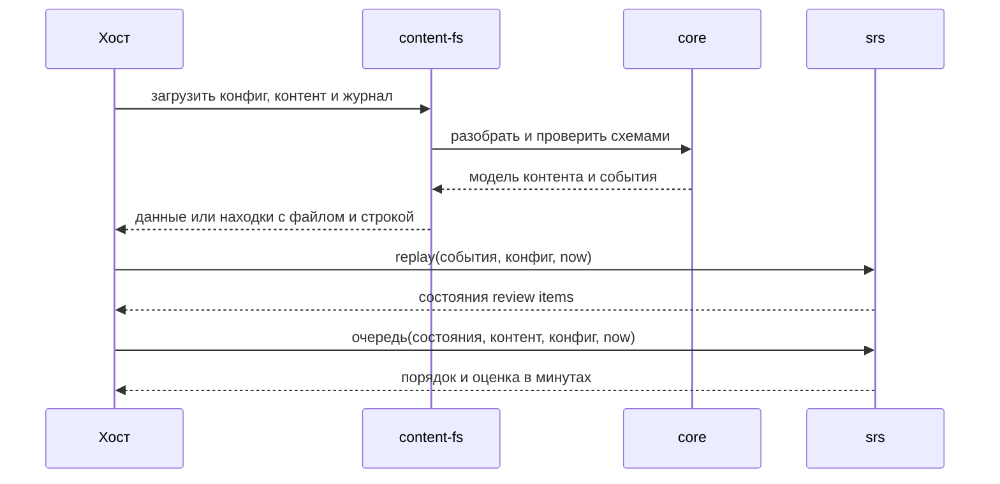

# Happy path - M2, ядро

[⌂ index](index.md)

## Одной фразой

После M2 одна команда скажет, что контент корректен, вторая соберёт его для приложения, а любая программа поверх ядра получит из журнала честное расписание и очередь на сегодня.

## До и после

| | До M2 | После M2 |
| --- | --- | --- |
| Проверка контента | Только mdlint; дубль `id` или слишком длинный ответ проходят | `wastech-learn check` ловит правила второго уровня и расхождение пресета |
| Диаграммы | Временный скрипт в контент-репозитории | `wastech-learn render` с тем же маркером `source-sha256` |
| Данные для UI | `build-data.mjs` прототипа, своя логика | `wastech-learn build` - content bundle по контракту |
| Расписание | Демонстрационные интервалы и R | Replay журнала через ts-fsrs 6, FSRS-7 |
| После перерыва | Неизвестно, сколько займёт возврат | `wastech-learn simulate` показывает, за сколько дней разберётся бэклог |

## Пример 1 - карточка с ошибкой

Автор добавил карточку `basic`, ответ в ней вышел на 19 слов, а `id` случайно совпал с уже существующим.

```text
$ wastech-learn check --content ../wastech-learn-content
content/architecture/backpressure/cards/7k2m9xqd.md
  error  answer-words   Ответ 19 слов, для basic не больше 12
  error  id-unique      id 7k2m9xqd уже есть в content/dotnet/async-await/cards/7k2m9xqd.md
1 файл, 2 ошибки, 0 предупреждений
```

Код выхода `1`: CI контента и MCP (в M3) не пропустят запись. Сообщение называет файл и правило, но не цитирует текст карточки.

## Пример 2 - вечер после двух недель перерыва

Хост (позже сервер или квиз в чате) читает журнал, делает replay на `now` и строит очередь. Due накопилось 180 review items, лимит - 150 в день.

- Бэклог больше `2 × reviewsPerDay`? Нет, но больше лимита дня - новые карточки на паузе.
- Очередь: сначала learning с подошедшим шагом, потом due из разных доменов вперемешку в порядке политики, без двух вариантов одной карточки в один день.
- Режим «15 минут» берёт из очереди столько, сколько помещается по оценке времени, - примерно 45 карточек.

Перед этим `simulate` уже проверил ту же политику на синтетическом журнале: 14 дней перерыва должны разбираться сессиями по 15 минут не дольше 5 дней - это критерий выхода MVP. Числа в примерах иллюстративные.

## Поток данных



## Последовательность для хоста


