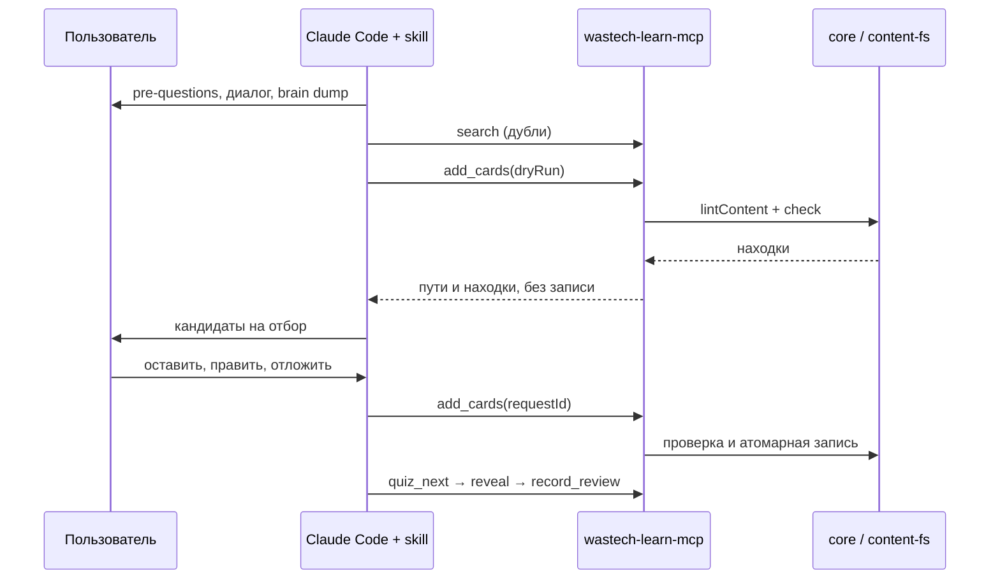

# Happy path - M3, захват

[⌂ index](index.md)

## Одной фразой

Разобрал тему в чате - через 15 минут она лежит в репозитории файлами, а первые карточки уже повторены прямо в чате.

## До и после

| | До M3 | После M3 |
| --- | --- | --- |
| Тема из Claude Code | Разговор остаётся в чате; файлы пишутся вручную | «Разберём тему X» → `learn-capture` ведёт цикл и пишет файлы через MCP |
| Тема из ChatGPT | Выгрузить некуда | Промпт экспорта → файл в `inbox/` → `learn-import` |
| Качество записи | Проверяется после, руками | Ничего невалидного не записывается: mdlint и `check` до записи, hook на ручные правки |
| Повторение | Только после M4 | «Погоняй меня» → `learn-quiz`, оценки пишутся в журнал |

## Пример 1 - тема в Claude Code

Пользователь пишет: «разберём idempotency keys в платёжных API».

1. `learn-capture` через `search` проверяет, что такой темы нет, и задаёт 4 pre-question; ответы с уверенностью уходят в `## Pretest`.
2. Диалог в режиме тьютора: сначала попытка, подсказки по одной.
3. Brain dump: пользователь своими словами формулирует суть, ИИ отмечает пробел про срок жизни ключа.
4. 12 кандидатов; `search` находит похожую карточку в теме про retries и показывает её рядом. `add_cards` с `dryRun` находит слишком длинный ответ у одного кандидата - ИИ сокращает.
5. Пользователь оставляет 8, правит 3, одну откладывает в `draft`. `add_cards` записывает их.
6. `save_summary`, `save_materials`, `save_diagram` (sequence-диаграмма с `alt`).
7. Мини-квиз из 3 новых карточек; оценки записаны в `reviews/desk1/mcp-2026-12.jsonl`.
8. Итог одной строкой: «Тема записана: 8 карточек, первое повторение завтра ≈ 3 мин».

## Пример 2 - тема из ChatGPT

1. В конце разговора пользователь вставляет промпт экспорта, сохраняет ответ в `inbox/idempotency-keys.md`.
2. В Claude Code: «импортируй из inbox». `import_package` разбирает пакет и возвращает тему и 10 кандидатов.
3. Отбор кандидатов, как в примере 1; тема уже существует - новые секции добавляются, старые не перезаписываются.
4. Пакет переезжает в `inbox/done/`.

## Пример 3 - квиз вечером

`queue_status` → «Due 18 ≈ 5 мин. Начинаем?» → `quiz_next(5)` отдаёт вопросы без ответов → пользователь отвечает с уверенностью → `reveal` → ИИ разбирает ответ по рубрике и предлагает Hard → пользователь соглашается → `record_review(rating 2, aiSuggested 2, grader ai:claude-code)`.

Числа и темы в примерах иллюстративные.

## Поток захвата

