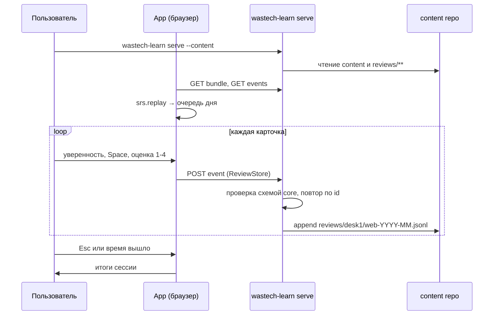
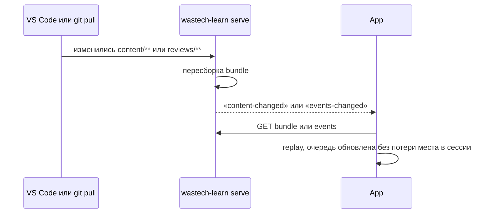

# Happy path - M4, приложение

[⌂ index](index.md)

## Одной фразой

Одна команда - и вечером в браузере идёт спокойная сессия с клавиатуры: вопрос, попытка, ответ со схемой, оценка, а каждая оценка уже лежит в журнале.

## До и после

| | До M4 | После M4 |
| --- | --- | --- |
| Повторение | Только в чате батчами до 10, без схем и кода | `wastech-learn serve` → браузер → сессия любой длины, только с клавиатуры |
| Чтение темы | Markdown в VS Code, схемы отдельными файлами | Страница темы: оглавление, схемы, подсвеченный код, скрытый Self-check |
| Поиск | `search` через MCP в чате | `/` в приложении, мгновенно и без сети |
| После перерыва | Чат показывает «Due 180» | Главная предлагает план возврата на 3 дня по 15 минут |
| Прогресс | Нигде | Итоги сессии и Stats: true retention и прогноз нагрузки |
| Польский | Текст в чате | Кнопка 🔊 и клавиша `p` |

## Пример 1 - вечерняя сессия

1. В терминале: `wastech-learn serve --content ~/Projects/wastech-learn-content`. Открывается браузер с главной: «Сегодня 23 карточки ≈ 6 мин».
2. `Enter` - режим «5 минут». Первая карточка про backpressure: пользователь думает, жмёт `2` («скорее да»), затем `Space`.
3. Ответ со схемой Producer → Consumer и четыре кнопки с интервалами «<10 мин · 2 дн · 4 дн · 9 дн». Пользователь жмёт `3`. Событие `review` уходит на сервер и дописывается в `reviews/desk1/web-2026-11.jsonl`; следующая карточка уже на экране.
4. На карточке `scenario` вместо ответа рубрика из 4 пунктов. Пользователь отмечает 3, приложение предлагает Hard, пользователь соглашается.
5. Слово `rachunek`: `p` озвучивает его, `Space`, `1` - «Не вспомнил - покажу позже».
6. Ошибся с оценкой - `u` отменяет последнюю, карточка возвращается.
7. Пять минут вышли, текущая карточка дорешана. Итоги: «Готово: 19 карточек за 5 мин. Вспомнил 16 из 19 · ошибки при уверенности „точно“: 1 → [разобрать]. Дальше: завтра ≈ 18». Стрика нет.

## Пример 2 - правка карточки на лету

1. На карточке пользователь видит неудачную формулировку и жмёт `e` - файл открывается в VS Code.
2. Он сокращает вопрос и сохраняет. Hook контент-репозитория проверяет файл; сервер видит изменение, пересобирает bundle и сообщает приложению.
3. Меньше чем через 2 с карточка в приложении обновлена; рядом значок «изменена», потому что `contentHash` не совпадает с прошлым повторением. Смысл не менялся - пользователь просто оценивает дальше.

## Пример 3 - возврат после двух недель

1. Главная: «С возвращением! Накопилось 180 карточек ≈ 45 мин. Предлагаю разобрать за 3 дня по 15 минут - новые карточки пока на паузе».
2. «15 минут» берёт review items с самой низкой R. Через три вечера бэклог разобран, новые карточки возвращаются половинным лимитом.

## Пример 4 - второй компьютер

На ноутбуке `git pull` приносит строки `reviews/desk1/*`. Сервер на ноутбуке видит изменения журнала, приложение делает replay по журналам всех устройств - очередь та же, что на десктопе. Оценки пишутся в `reviews/laptop/web-2026-11.jsonl`, `git push` проходит без конфликтов.

Числа и темы в примерах иллюстративные.

## Поток сессии

## Поток изменения файлов

