# Why a consumer signals demand

## Question

[Streaming] Why does a consumer signal demand to the producer?

## Answer

So the producer never sends more than the consumer can buffer and process.

## Explanation

## Sources

- [Summary: Diagram](../summary.md#diagram)
