# Backpressure

## TL;DR

Backpressure is a feedback signal from a slower consumer that makes a faster producer slow down, so buffers stay bounded instead of growing until memory runs out.

## Mental model

A sink with a narrow drain: if the tap (producer) runs faster than the drain (consumer), the sink (buffer) overflows. Backpressure is the drain telling the tap how much it can take right now. Under overload there are only three levers: slow the producer, buffer within a limit, or shed load.

## Diagram



The consumer pulls with `request(n)`; the bounded buffer never holds more than its capacity.

## Worked example

A bounded .NET channel between an HTTP endpoint and a background worker:

```csharp
var channel = Channel.CreateBounded<Order>(new BoundedChannelOptions(100)
{
    FullMode = BoundedChannelFullMode.Wait // [!code highlight]
});

// producer: WriteAsync waits while the channel is full - this is backpressure
await channel.Writer.WriteAsync(order, ct);

// consumer: processes at its own pace
await foreach (var o in channel.Reader.ReadAllAsync(ct))
    await HandleAsync(o, ct);
```

When the worker falls behind, `WriteAsync` stops completing, request handlers wait, and the slowdown propagates upstream instead of filling memory.

## Trade-offs

| Strategy | Keeps | Costs |
| --- | --- | --- |
| Wait (block the producer) | Every item, bounded memory | Producer latency, upstream timeouts |
| Bounded buffer | Absorbs short bursts | Memory, added latency |
| Drop or shed | Low consumer latency | Lost or rejected items |
| Sample or conflate | The latest state | Intermediate values |

## When not to use

- Telemetry where loss is acceptable: dropping is simpler than propagating a slowdown.
- The producer cannot slow down (sensor, third-party webhook): accept into a durable queue and scale consumers.

## Misconceptions

- "A bigger buffer fixes it" - it only delays the overflow and adds latency.
- "Rate limiting is backpressure" - a fixed limit does not react to downstream capacity.
- "Autoscaling makes it unnecessary" - scaling takes minutes; backpressure acts in milliseconds.

## Comparison

| Mechanism | Who sets the pace | Knob |
| --- | --- | --- |
| TCP flow control | Receiver window | `rwnd` |
| Reactive Streams | Subscriber demand | `request(n)` |
| Kafka consumer | Consumer pull | `max.poll.records` |
| .NET Channels | Bounded capacity | `BoundedChannelFullMode` |

## Self-check

1. What grows without backpressure between a fast producer and a slow consumer?
2. Name the three levers when a consumer is overloaded.
3. Why is a bigger buffer not a fix?

## Related

- [Async/await in .NET](../../dotnet/async-await/index.md): `WriteAsync` waits without blocking a thread.
- Rate limiting and load shedding: next topics to capture.

## Open questions

- How do gRPC streams expose flow control to application code?
- When should a bounded channel use `DropOldest` instead of `Wait`?

## Sources

- [Reactive Streams specification](https://www.reactive-streams.org/)
- [Channels in .NET](https://learn.microsoft.com/en-us/dotnet/core/extensions/channels)
- [Google SRE book: Handling overload](https://sre.google/sre-book/handling-overload/)
