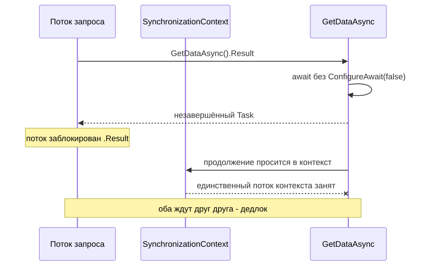

# Дедлок в классическом ASP.NET

## Question

[ASP.NET, .NET Framework] Действие контроллера вызывает `GetDataAsync().Result`, внутри — `await` без `ConfigureAwait(false)`. Запрос зависает навсегда. Почему?

## Answer

Продолжение ждёт захваченный контекст запроса, а его поток заблокирован `.Result` — взаимная блокировка.

## Rubric

- (!) Продолжение возвращается в захваченный SynchronizationContext
- (!) Поток этого контекста заблокирован `.Result`
- Исправление: async до самого верха или `ConfigureAwait(false)` в библиотеке

## Explanation

## Sources

- [Summary: Diagram](../summary.md#diagram)
