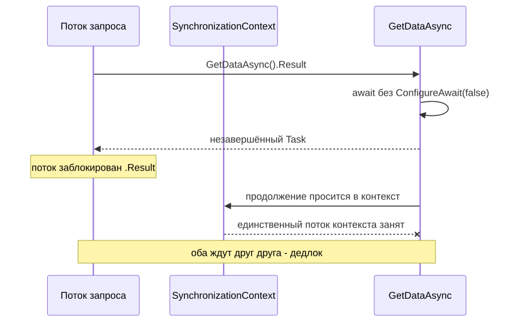

# Async/await в .NET

## TL;DR

`async`/`await` - это не многопоточность, а способ не держать поток, пока идёт ожидание. Главная ловушка - sync-over-async: блокирующее ожидание (`.Result`, `.Wait()`) асинхронного кода.

## Mental model

Компилятор превращает метод в конечный автомат. До первого незавершённого `await` метод выполняется синхронно в потоке вызывающего. На `await` он возвращает незавершённый `Task`, а продолжение регистрируется: если был `SynchronizationContext` (UI, классический ASP.NET), продолжение вернётся в него, иначе - в пул потоков.

## Diagram



Продолжению нужен контекст запроса, а единственный его поток ждёт `.Result` - оба ждут друг друга.

## Worked example

```csharp
// Библиотека: контекст вызывающего не нужен
public async Task<Report> GetReportAsync(CancellationToken ct)
{
    var json = await _http.GetStringAsync(_url, ct).ConfigureAwait(false); // [!code highlight]
    return Report.Parse(json);
}

// Приложение: async до самого верха, без .Result
public async Task<IActionResult> Get(CancellationToken ct) =>
    Ok(await _reports.GetReportAsync(ct));
```

## Trade-offs

| Приём | Плюс | Цена |
| --- | --- | --- |
| `ConfigureAwait(false)` | Нет захвата контекста, нет дедлока, чуть быстрее | После `await` нельзя трогать UI и `HttpContext.Current` |
| `ValueTask<T>` | Нет аллокации на синхронном пути | Нельзя ждать дважды, сложнее в использовании |
| Async до самого верха | Ни одного заблокированного потока | Сигнатуры меняются по всей цепочке вызовов |

## When not to use

- `ConfigureAwait(false)` в коде UI, которому после `await` нужен UI-поток.
- `ValueTask` в публичном API, если результат могут ждать несколько раз или сохранять.
- `async` ради одной строки, которая просто возвращает `Task` дальше: можно вернуть `Task` без `await`, если нет `using` и `try`.

## Misconceptions

- «`async` запускает новый поток» - нет, до первого незавершённого `await` всё идёт синхронно.
- «В ASP.NET Core `.Result` безопасен» - классического дедлока нет (нет контекста), но поток пула заблокирован, и под нагрузкой пул голодает.
- «`ConfigureAwait(false)` больше не нужен» - в коде приложения ASP.NET Core да, в библиотеках по-прежнему нужен: их вызывают и из UI.

## Comparison

| Сигнатура | Исключение | Можно ждать | Когда |
| --- | --- | --- | --- |
| `async Task` | В `Task`, ловится через `await` | Да | По умолчанию |
| `async ValueTask<T>` | В `ValueTask` | Один раз | Горячий путь, часто синхронный |
| `async void` | Уходит в контекст, может уронить процесс | Нет | Только обработчики событий |

## Self-check

1. Что выполняется синхронно при вызове async-метода?
2. Почему `.Result` вешает классический ASP.NET, но не ASP.NET Core?
3. Чем опасен `async void`?

## Related

- [Backpressure](../../architecture/backpressure/index.md): `ChannelWriter.WriteAsync` ждёт место в канале, не блокируя поток.

## Open questions

- Как `IAsyncEnumerable` сочетается с отменой и backpressure?
- Когда оправдан `Task.Run` в ASP.NET Core?

## Sources

- [ConfigureAwait FAQ - .NET Blog](https://devblogs.microsoft.com/dotnet/configureawait-faq/)
- [Don't Block on Async Code - Stephen Cleary](https://blog.stephencleary.com/2012/07/dont-block-on-async-code.html)
- [Understanding the Whys, Whats, and Whens of ValueTask - .NET Blog](https://devblogs.microsoft.com/dotnet/understanding-the-whys-whats-and-whens-of-valuetask/)
